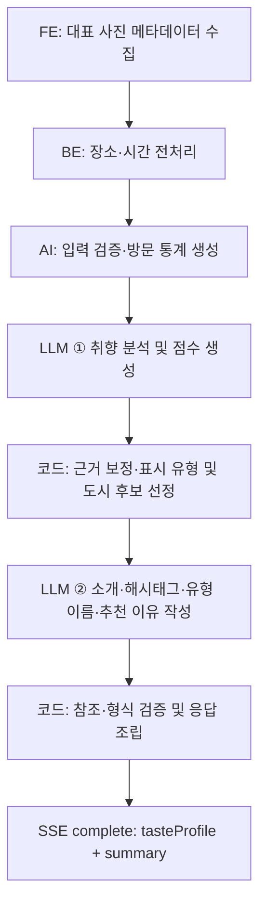

# [DOM-4] 취향 분석 프로세스

> 💡 **사진 메타데이터 → 방문 통계 → 취향 분석 → 근거 보정 → 화면 요약 → API 응답**

정상 처리 시 LLM을 **순차적으로 2회** 호출한다. 첫 호출은 취향 점수 생성, 두 번째 호출은 보정된 취향을 소개 문구로 표현하는 역할이다.

기준: 2026-10-14 Yeolo-AI 구현 및 API-AI-1. 배포 여부와 실제 LLM 품질 검증은 별도로 확인한다.


## 1. 목적과 입력

사용자가 동의한 사진의 **위치·촬영 시간 메타데이터**에서 여행 관심사를 파악하고, 화면에 표시할 취향 소개와 추천 도시를 만든다. 사진 원본·픽셀 분석이나 추가 설문은 사용하지 않는다.

| 담당 | 처리 및 전달 정보 |
| :--- | :--- |
| Yeolo-FE | 사용자 동의와 사진 접근 권한을 확인하고 대표 사진의 ID·촬영 시각·좌표를 수집한다. |
| BE | 좌표·시간을 장소·시간 정보로 가공해 API-AI-1을 호출한다. 결과 저장과 프로필 ID 발급을 담당한다. |
| Yeolo-AI | 방문을 집계하고 취향을 분석·보정한 뒤, 화면 요약을 생성해 SSE로 반환한다. |

AI 요청은 `userId`, `language`, `items`로 구성된다. 각 항목에는 `sourceImageId`, 장소 정보 `location`, 시간 정보 `timeContext`가 들어간다.

- **장소 정보:** 국가·도시·지역·행정구역·장소명·장소 유형.
- **시간 정보:** 촬영 시각·요일·주말 여부·시간대·계절. 촬영 시각에는 UTC 또는 offset이 있어야 한다.
- **출력 언어:** 본문의 `language`를 우선 사용한다. 생략하면 `Accept-Language`, 사용 가능한 값이 없으면 `ko`를 적용한다.
**최소 입력과 충분한 근거는 다르다.** AI는 유효 기록이 1개 이상이면 분석할 수 있지만, 높은 점수에는 반복 방문 근거가 필요하다. 기존 FE 수집 정책은 대표 기록 5개 이상·서로 다른 UTC 날짜 3일 이상이며, 상세는 하단 기록을 참고한다.


## 2. 전체 처리 흐름



| 단계 | 핵심 처리 | 산출물 |
| :--- | :--- | :--- |
| ① 입력 검증·방문 집계 | 무효 기록과 중복 사진 ID를 제외한다. 같은 장소·같은 날짜에서 첫 촬영부터 2시간 이내인 사진을 한 방문으로 묶는다. | 방문 수, 날짜·장소 다양성, 장소 유형·계절·도시 분포, 항목별 근거 |
| ② 취향 분석 — LLM 1회 | 방문 통계를 받아 기존 8개 취향 영역을 구조화된 형태로 생성한다. | 36개 점수와 일정·소비·동행·계절 정보 |
| ③ 근거 보정 — 코드 | 반복 방문 근거에 따라 점수를 보정하고 계절·환경 항목을 최소 1개 선택한다. | 최종 tasteProfile 및 내부 근거 metadata |
| ④ 요약 입력 선정 — 코드 | 근거가 있는 관심사 최대 3개와 해당 관심사에 맞는 도시 후보를 고른다. | 요약용 관심사·근거·표시 점수·도시 후보 |
| ⑤ 화면 요약 — LLM 1회 | 선정된 근거로 소개, 해시태그, 맞춤 유형 이름, 도시 선택과 추천 이유를 작성한다. | summary 초안 |
| ⑥ 검증·응답 조립 — 코드 | 유형·도시 참조와 길이·형식을 검증하고 서버가 점수·축 이름·국가·도시명을 결합한다. | tasteProfile + summary |

같은 카페에서 사진 20장을 찍어도 같은 방문 묶음이면 카페 근거는 1회다. **사진 장수 자체를 선호 강도로 해석하지 않는다.**

두 번째 LLM은 점수를 다시 채점하지 않는다. 최초 분석 결과를 코드로 보정한 뒤, 그중 화면에서 설명할 수 있는 근거만 전달한다.


## 3. 취향 점수와 계절 정보


### 기존 취향 정보 유지

| 필드 | 결과 |
| :--- | :--- |
| `travelPurpose` | 여행 목적 10개 점수 |
| `preferredLocationType` | 장소 유형 9개 점수 |
| `activityPreference` | 활동 9개 점수 |
| `foodPreference` | 음식 8개 점수 |
| `travelPaceDensity` · `spendingTendency` · `companionType` | 일정 밀도·소비 성향·동행 형태 |
| `seasonalEnvironmentPreference` | 계절·환경 선호 목록, 최소 1개 |


### 점수 보정 기준

원래 점수 계약은 1–5 정수다. 현재 방문 근거 보정 후에는 **3·4·5점**을 사용한다.

| 조건 | 최종 처리 |
| :--- | :--- |
| 해당 항목의 근거가 3방문 이상·서로 다른 날짜 2일 이상 | LLM이 부여한 4–5점을 유지할 수 있다. |
| 근거가 없거나 반복 기준 미달 | 3점으로 보정한다. |
| LLM이 1–2점 반환 | 3점으로 보정한다. 관측되지 않았다는 이유로 비선호를 확정하지 않는다. |

**3점은 중립·미확정**이다. 4–5점도 취향이 맞을 확률이 아니라, 관측 기록을 해석한 관심 점수다. 예를 들어 야간 촬영만으로 밤문화를 높이지 않으며, 일반 식당 방문만으로 현지식·유명 맛집·파인다이닝을 확정하지 않는다.

동행·소비·일정은 현재 입력으로 확인할 수 없어 `solo`, `moderate`, `balanced`를 호환 기본값으로 반환한다. 이 값으로 소개 문구나 표시 유형을 만들지 않는다.


### 계절·환경은 최소 1개

1. **반복 활동 근거:** 3방문·2일 기준을 만족한 계절 활동 후보를 선택한다.
1. **약한 활동 근거:** 관측 후보 중 방문 수·날짜 수가 가장 큰 1개를 잠정 선택한다.
1. **활동 근거 없음:** 가장 많이 관측된 촬영 계절로 UI용 잠정값 1개를 선택한다.
여름 해변·리조트는 `summer_resort`, 겨울 스키장은 `winter_sports`, 봄·가을 식물원은 `spring_flower_autumn_foliage`의 근거가 된다. 활동 근거가 없으면 여름 → `warm_region`, 겨울 → `cold_region`, 봄·가을 → `spring_flower_autumn_foliage`를 사용한다.

**계절 잠정값은 실제 기후 선호를 입증하지 않는다.** 최소 표시 정책으로 생성된 값은 요약의 성향 근거에서 제외한다.


## 4. 화면에 표시할 요약

| 필드 | 의미와 생성 규칙 |
| :--- | :--- |
| `intro` | 어떤 여행 관심사를 가진 사람인지 한 문장으로 설명한다. 한국어 약 40자를 목표로 하며 스키마 상한은 96자다. |
| `hashtags` | 짧고 중복 없는 3–4개. 기본 3개이며 #을 붙이고 공백을 넣지 않는다. 개별 태그와 전체 길이를 함께 제한한다. |
| `types` | 근거가 있는 관심사 0–3개. typeCode는 서버가 선정하고 typeName은 사용자에 맞게 표현한다. |
| `types[].score` | 보정된 점수를 서버가 0–100 표시값으로 변환한다. LLM은 수정하지 못한다. |
| `types[].lowName / highName` | 한국어 기준 약함 / 강함. 관심 신호의 강도를 표시한다. |
| `recommendCity` | 허용된 후보 중 도시 하나를 선택하고, 국가·도시·추천 이유를 제공한다. 국가·도시 이름은 서버 목록에서 결합한다. |


### 표시 유형과 점수

**반복 근거가 충분하고 보정 점수가 4점 이상인 항목**만 선택한다. 점수 → 근거 날짜 수 → 방문 수 순으로 정렬하며, 비슷한 그룹에서는 하나만 남겨 최대 3개를 표시한다.

표시 점수는 `(기존 점수 - 1) × 25`다. 따라서 현재 선정 조건에서는 **4점 → 75, 5점 → 100**이 표시된다. 확률이나 여행자 백분위가 아니며, 자연과 도시처럼 서로 배타적이지 않은 관심사를 반대 축으로 만들지 않는다.

근거가 부족하면 유형을 억지로 채우지 않아 `types`가 0–2개일 수 있다. 전혀 없으면 빈 배열과 취향을 알아가는 단계의 소개·해시태그를 제공하고, 도시는 일반적인 탐색 출발점으로 설명한다.


### 추천 도시

초기 후보는 **서울·부산·교토·도쿄·리스본·바르셀로나·밴쿠버·싱가포르**다. 표시 유형이 있으면 최소 하나가 도시의 관심 태그와 맞는 후보만 LLM에 전달한다.

추천 이유는 관측된 관심사와 후보 도시의 특성을 연결한다. 실시간 가격·날씨·영업 여부 등을 조회하는 단계는 없다.

<details><summary>summary 응답 예시</summary>

아래는 카페·디저트에 충분한 근거가 있고 보정 점수가 4점인 경우의 예시다. 실제 complete에는 기존 tasteProfile 객체도 함께 들어간다.

```json
{
  "intro": "카페와 디저트를 찾아 여행의 즐거움을 더하는 타입",
  "hashtags": ["#카페탐방", "#디저트", "#취향발견"],
  "types": [
    {
      "typeCode": "CAFE_DESSERT",
      "typeName": "카페·디저트 탐방",
      "lowName": "약함",
      "highName": "강함",
      "score": 75
    }
  ],
  "recommendCity": {
    "countryName": "포르투갈",
    "cityName": "리스본",
    "reason": "카페와 디저트에 대한 관심을 바탕으로 현지 카페 문화를 탐색하기 좋은 도시예요."
  }
}
```

</details>


## 5. API 응답과 실패 처리

**API-AI-1:** `POST /internal/ai/taste-profile/analysis` · `X-Internal-Api-Key` 인증 · SSE 응답. 기존 `/behavior` 별칭도 유지한다.

| 순서 | SSE 이벤트 | 내용 |
| :--- | :--- | :--- |
| 1 | progress | step=ANALYZING_PREFERENCE — 사용자 여행 성향을 분석 중입니다. |
| 2 | progress | step=GENERATING_SUMMARY — 사용자 취향 정보를 요약합니다. |
| 3 | complete | data의 최상위 필드는 tasteProfile과 summary 두 개다. |

내부 `analysisMetadata`와 추천용 `cityCode`는 공개 응답에 포함하지 않는다. 프로필 저장과 `tasteProfileId`, `updatedAt` 등 저장 식별·시점 정보는 BE 책임이다.

| 실패 시점·원인 | 응답 |
| :--- | :--- |
| 스트림 시작 전: 유효 기록 없음 | HTTP 400 |
| 스트림 시작 전: 잘못된 내부 인증 키 | HTTP 401 |
| 스트림 시작 전: AI 설정 오류 | HTTP 500 |
| 스트림 시작 후: LLM·구조화 출력·참조 검증 실패 또는 제한 시간 초과 | SSE error 후 종료. 부분 결과를 complete로 반환하지 않는다. |

두 LLM 호출은 `TASTE_ANALYSIS_TIMEOUT_SECONDS`의 **하나의 전체 제한 시간**을 공유한다. 자동 재시도나 추가 채점 요청은 없다. 요약이 실패하면 취향 점수만 성공 응답으로 내보내지 않는다.


## 6. 데이터 사용과 검증 범위

- **분석 LLM:** 집계된 방문 통계를 사용한다. 사진 ID·개별 촬영 시각·장소명 목록은 프롬프트에 넣지 않는다. 도시 분포 등 집계 정보는 포함된다.
- **요약 LLM:** 선정된 관심사와 근거 수치, 표시 점수, 언어, 허용 도시 후보만 사용한다. 원본 사진 기록이나 근거 없는 기본값은 입력하지 않는다.
- **내부 추적:** LangSmith의 `taste_profile_analysis`, `taste_profile_summary` 단계로 구분한다. 분석 metadata에 항목별 근거와 기본값·잠정값 사유를 남기며, 공개 응답에서는 제외한다.
- **검증의 의미:** 코드가 형식·길이·유형 및 도시 참조를 검사한다. 문구가 근거를 과장하지 않는지는 프롬프트 지침과 별도 품질 평가로 확인해야 한다.
현재 2회 호출 구조는 **외부 API를 격리한 자동 테스트**로 순서·API 응답·SDK 요청 형식·실패 처리를 확인했다. 실제 LLM 응답 품질 및 LangSmith 수신은 이번 구조로 다시 검증해야 한다.

남은 제품 연동 사항은 유형이 0–2개일 때의 UI, 태그의 실제 화면 폭, 계절 잠정값 표시다. 방문 표본은 생활·업무·여행 기록을 자동 구분하지 않으며, 사용자별 모델 학습이나 누적 프로필 갱신도 현재 과정에 포함되지 않는다.


## 7. 개발 상세 및 참고

<details><summary>표시 유형 매핑과 요약 검증</summary>

| typeCode | 기존 점수 출처 | 중복 제한 그룹 |
| :--- | :--- | :--- |
| CAFE_DESSERT | foodPreference.cafeDessert | 음식 |
| CULTURE | activityPreference.viewing | 문화 |
| BEACH | preferredLocationType.beachResort | 자연 |
| OUTDOOR | activityPreference.adventure | 활동 |
| NATURE | travelPurpose.natureExploration | 자연 |
| FOOD | travelPurpose.gourmet | 음식 |
| SHOPPING | [activityPreference.shopping](http://activitypreference.shopping/) | 쇼핑 |
| NIGHTLIFE | activityPreference.nightlife | 밤문화 |
| WELLNESS | travelPurpose.wellness | 웰니스 |
| EXPERIENCE | activityPreference.experience | 활동 |

같은 그룹에서 최대 하나를 선택한다. 점수·날짜·방문 수까지 같으면 위 등록 순서로 결정한다.

LLM은 선정된 typeCode를 중복·누락 없이 사용하고 typeName만 작성한다. 새 유형 생성이나 점수 변경은 허용하지 않는다. typeName 상한은 24자, 추천 이유 상한은 160자다.

해시태그는 NFKC 정규화 후 #으로 시작하며 문자·숫자·밑줄만 허용한다. 전각 문자는 폭 2, 나머지는 1로 계산하여 태그당 15 이하, 태그 사이 간격을 포함한 전체는 48 이하로 제한한다. 픽셀 폭 보장은 FE에서 확인한다.

intro·hashtags·typeName·reason은 요청 언어로 생성한다. 국가·도시명은 한국어 요청이면 한국어, 그 외에는 등록된 영어 고유명사를 사용한다. 축 이름은 지원 언어 표를 사용하고 미지원 언어는 영어로 대체한다.

</details>

<details><summary>방문 집계·보정·추적 세부 규칙</summary>

- 빈 사진 ID, timezone 없는·파싱 불가·UTC 범위 밖 시각, 빈 장소명·unknown 등을 제외한다. 같은 사진 ID의 내용이 충돌하면 정렬된 JSON을 기준으로 한 기록을 선택한다.
- 장소 키는 국가·도시·지역·행정구역·장소명을 NFKC·공백 축약·casefold로 정규화해 만든다. 실제 장소 ID나 장소 timezone을 추가 조회하지 않는다.
- 방문 날짜는 입력 시각의 offset을 따른다. 2시간 묶음의 기준점은 첫 촬영 시각에 고정한다. 방문별 장소 유형은 합집합이며 항목별 방문·날짜 수는 중복을 제거해 집계한다.
- 요일·주말·시간대는 대표 시각에서 다시 계산하고 계절은 BE 입력을 유지한다. 00–05시 dawn, 06–11시 morning, 12–17시 afternoon, 18–21시 evening, 22–23시 night다.
- dataSufficiency는 10일 이상·15곳 이상일 때 sufficient, 나머지는 provisional이다. API 최소 입력이나 항목별 3방문·2일 기준과는 다른 내부 휴리스틱이다.
- 계절 활동 후보는 여름 beach/resort_hotel, 겨울 ski_resort, 봄·가을 botanical_garden이다. 약한 후보 동률은 방문 수 → 날짜 수 → summer_resort/winter_sports/spring_flower_autumn_foliage 등록 순서로 결정한다. 촬영 계절 동률은 spring/summer/autumn/winter 순서다.
- dry_weather·off_season·peak_season은 기후·성수기 근거가 없어 확정하지 않는다. 식물원 방문도 실제 꽃·단풍 관람 목적을 입증하는 것은 아니다.
- 내부 metadata는 statistics, fieldEvidence, fallbackFields, requiresUserConfirmation 등을 포함한다. confidence의 low/medium은 근거 수준이며 정확도 확률이 아니다. requiresUserConfirmation은 내부 표시로, 사용자 설문을 실제 실행하는 단계가 아니다.
- userId는 ABTO 호출 추적에 사용한다. 두 호출 모두 기존 taste.profile.analysis 기능 경로를 사용하며 원본 사진을 추가 전송하지 않는다.
- LangSmith가 비활성화되면 원격 추적은 저장되지 않는다. metadata 기록 실패는 정상 분석을 중단하지 않는다.
</details>

<details><summary>FE 수집 정책 기록 — 2026-10-03 확인</summary>

이 내용은 기존 문서의 FE 구현 기록을 요약한 것이다. 이번 문서 갱신에서는 FE 코드를 다시 검증하지 않았다.

1. 분석 동의를 저장하고 사진 읽기 권한을 요청한다. 일부 사진 접근도 허용된 범위에서 처리한다.
1. 최근 365일을 12개 구간으로 나누고 구간별 최신 250개, 전체 최대 3,000개 후보를 확인한다. 자산 메타데이터 조회는 최대 4개 병렬이다.
1. 유효한 ID·생성 시각·좌표를 가진 기록만 남긴다. 생성 시각이 실제 촬영 EXIF와 같은지는 별도 확인 대상이다.
1. 같은 UTC 날짜에서 대표 위치 100m 이내·대표 시각부터 2시간 이내의 사진을 근사 방문으로 묶어 하나를 남긴다.
1. 하루 최대 5개, 날짜별 하나 우선 및 기간 순환 선택으로 대표 기록 최대 100개를 구성한다.
1. 대표 기록 5개 이상·서로 다른 UTC 날짜 3일 이상이면 BE에 전송한다. 부족하면 분석 요청 없이 안내하며 제한 접근에서는 사진 추가 선택을 위한 설정 이동을 제공한다.
FE → BE 필드는 sourceImageId, capturedAt, latitude, longitude, timezone이다. 당시 capturedAt은 자산 생성 시각을 UTC로 변환한 값이고 timezone 기본값도 UTC였다.

FE의 좌표 기반 표본 묶음과 AI의 장소 키 기반 방문 집계는 목적과 기준이 다르다. 상한이 있는 표본을 실제 전체 방문 빈도로 해석하지 않으며, UTC 날짜와 장소 현지 시간의 정합성은 BE 연동에서 확인해야 한다.

참고 코드: packages/app/src/services/photoService.ts, photoSelection.ts, constants/config.ts, hooks/useTasteAnalysisPipeline.ts, packages/common/src/api/taste.ts.

당시 검증: 앱 Jest 28 suites/238 tests, TypeScript, 변경 파일 형식 검사 및 Android Debug 빌드 통과. 네이티브 보관함은 mock으로 검증했으며 실제 기기 수집·전송 검증은 별도다.

</details>

<details><summary>검증 이력과 구현 위치</summary>

**현재 2회 호출 구조 — 2026-10-14**

관련 선택 검증 114개 및 당시 전체 검증 931개 통과. 환경·하네스·셸 문법·Ruff 검사를 통과했으며 정적 타입 검사는 미구성이다. 실제 SDK 직렬화 요청을 MockTransport로 검증했다.

확인 범위: 분석 후 요약 2회 순서, SSE 단계·완료 형태, 근거 없는 값의 요약 제외, 유형·도시 참조, 언어·태그 길이, 제한 시간·취소·클라이언트 종료. 실제 외부 LLM과 LangSmith 수신은 미실행이다.

**이전 단일 호출 구조 — 2026-10-03**

실제 Gemini·LangSmith 합성 테스트 3건으로 정상 실행을 확인한 이력이 있다. 전체 프로필 테스트는 사진 49개 → 32방문, 8개 영역·36개 점수·51개 검사 통과였다. 이는 현재 요약 호출의 검증 근거가 아니다.

[이전 단일 호출 구현 PR #45](https://github.com/Software-Maestro-GTA/Yeolo-AI/pull/45)

[이전 전체 프로필 실제 LLM 검증 보고서](https://github.com/Software-Maestro-GTA/Yeolo-AI/blob/codex/taste-profile-single-call/docs/taste-analysis/live-verification-full-profile-2026-10-03/report.md)

**AI 구현 위치**

- API·요청: app/api/taste_[profile.py](http://profile.py/), app/schemas/[behavior.py](http://behavior.py/).
- 집계·보정: app/services/behavior_[statistics.py](http://statistics.py/), behavior_[evidence.py](http://evidence.py/).
- 실행·요약 조립: app/services/behavior_[service.py](http://service.py/), taste_[summary.py](http://summary.py/).
- LLM 호출·프롬프트: app/agent/taste_profile_[chains.py](http://chains.py/), [prompts.py](http://prompts.py/), taste_summary_[prompt.py](http://prompt.py/).
- 응답 스키마: app/schemas/taste_[profile.py](http://profile.py/), taste_[summary.py](http://summary.py/).
- 회귀 테스트: tests/test_behavior_[analysis.py](http://analysis.py/), test_behavior_[statistics.py](http://statistics.py/), test_behavior_[evidence.py](http://evidence.py/), test_taste_[summary.py](http://summary.py/), test_gemini_[parameters.py](http://parameters.py/).
- 검증 명령: bash .agents/hooks/[test.sh](http://test.sh/).
</details>


### 관련 명세

- BE–AI 요청·응답 계약: [취향 분석](https://app.notion.com/p/3911d7341cda806b94eef019769865ae)
- 현재 취향 도메인: [취향 정보](https://app.notion.com/p/3911d7341cda80679169f4b58a9da359)
- FE–BE 분석 API: [취향 분석](https://app.notion.com/p/3911d7341cda8028902ce908c0d10791)
- 향후 개선안: [취향정보v2](https://app.notion.com/p/3f11d7341cda81e19f15e5545f20b2b4) — 제안 문서이며, 현재 파이프라인에 도입된 점수 모델은 아니다.
