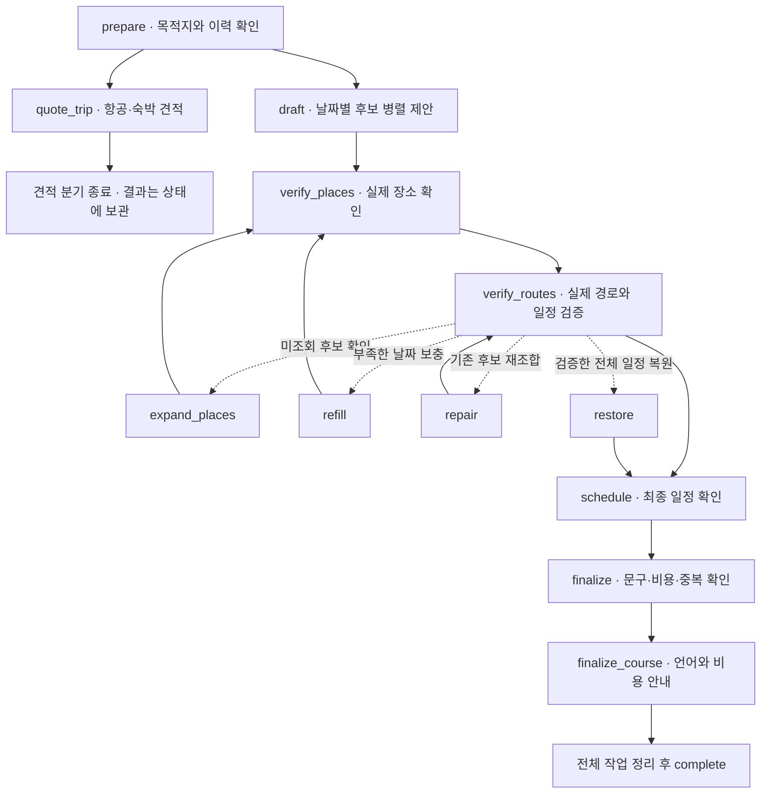

# [DOM-5] 코스 생성 프로세스

> 💡 **취향으로 후보를 제안하고, Google에서 실제 장소와 경로를 확인한 뒤 일정을 완성합니다.**

LangGraph가 날짜별 생성·검증·복구를 관리하고 실제 진행 상황을 SSE로 전달합니다. 정상 일정은 하루 최소 5곳을 목표로 합니다.

**정리 기준:** 2026-10-15 · 현재 Yeolo-AI 로컬 코드와 확인한 검증 결과. 미커밋 변경을 포함하며 운영 배포 상태를 의미하지 않습니다.

**핵심:** 취향 프로필 우선 · 날짜별 LLM 병렬 호출 · Google Essentials · 요청 안의 중복 조회 방지 · 부족한 날짜만 복구 · 확보한 항공·숙박 견적 합산.


## 1. 입력과 결과

**API:** `POST /internal/ai/courses` · 내부 인증 `X-Internal-Api-Key` · JSON 요청 / SSE 응답.

| 입력 | 역할 |
| :--- | :--- |
| `userId` | 사용자·목적지별 최근 생성 이력을 조회합니다. |
| `language` | 추천 이유·방문 팁·진행 안내의 언어입니다. 예: `ko`, `en`, `ja`. |
| `tasteProfile` | 여행 목적, 장소·활동·음식·계절 선호, 일정 밀도, 소비 성향, 동행 형태를 반영합니다. |
| `mbti` | 취향 프로필이 없을 때 후보 제안의 보조 입력입니다. `tasteProfile`을 전달하면 `mbti: null`로 요청할 수 있습니다. |
| `tripCondition` | 국가·도시·시작일·여행 일수·숫자 예산 `budget`을 전달합니다. 예산 단위는 원화이며 초과가 불가피해도 생성합니다. |

취향 프로필과 MBTI 중 하나 이상이 필요합니다. 국가·도시는 공통 국가 코드·지역 유형·위치 범위로 확인하며 국가별 별칭 예외 목록을 사용하지 않습니다.

| 결과 | 현재 반환 필드 |
| :--- | :--- |
| 코스 | `title`, `destinationCountry`, `destinationCity`, `startDate`, `totalDays`, `totalCost`, `tags`, `itinerary` |
| 일차 | `day`, `date`, `stops` |
| 방문 | `sequence`, `stayMinutes`, `memo`, `reason`, `cost`, `place`, `transportToNext` |
| `place` | `placeId`, `placeName`, `category`, `latitude`, `longitude` |
| 다음 이동 | `type`, `distance`(미터), `minutes`(분), `memo`. 마지막 장소는 `type: none`입니다. |

- 공개 `placeId`는 `ChIJ...` 형태이며 **`places/`**** 접두사를 제거**합니다. 내부 검증·이력의 ID 형식은 유지합니다.
- `placeName`은 LLM이 제안해 검색한 이름입니다. Google 공식 표시 이름 `displayName`은 조회하지 않습니다.
- `category`는 **실제 Google 유형**을 앱의 7개 코드로 매핑합니다: FOOD·CAFE·SPOT·CULTURE·NATURE·ACTIVITY·NIGHTLIFE.
- 대표 이미지·장소 사진·사진 출처, 날짜별 요약, 공개 도착 시각, 상세 주소·평점·영업시간은 응답에서 제외했습니다. 도착 시각은 내부 일정 검증에 사용합니다.
**API 원문:** [여행 코스 생성](https://app.notion.com/p/9d81d7341cda830a92d981fb2cdc50f7)


## 2. 전체 생성 흐름

아래는 정상 흐름과 주요 복구 경로입니다. 세부 조건 분기는 단순화했습니다.



`draft`와 `quote_trip`는 같은 단계에서 병렬 실행됩니다. 견적 분기의 종료는 SSE 완료가 아니며 확보한 견적은 최종 비용 계산에 사용합니다.

| 노드 | 하는 일 |
| :--- | :--- |
| `prepare` | 목적지의 국가 코드·도시 유형·좌표 범위를 확인하고 최근 이력을 읽습니다. 이력 DB 장애는 제한된 중복 방지 상태로 계속 진행합니다. |
| `draft` | 날짜별 가까운 후보 9~10개를 제안합니다. 명소 최소 5개, 점심·저녁 대안 각 2개를 요청하며 최대 5일을 병렬 처리합니다. |
| `quote_trip` | MyRealTrip 항공·숙박 견적을 조회합니다. 실패한 항목은 비용 미확보로 처리합니다. |
| `verify_places` | ID 검색 후 좌표·주소·국가·유형을 검증합니다. 음식점과 명소 역할을 구분하고 지역 중심점·교통시설·부적합한 업종을 제외합니다. |
| `verify_routes` | 실제 이동 거리·시간, 체류·식사 시간, 날짜 간 장소 중복을 확인합니다. 실패한 날짜의 대안만 다시 검사합니다. |
| `schedule` | 모든 날짜, 방문 순서, 장소·이동 누락과 중복을 최종 확인합니다. |
| `finalize` | 검증된 유형과 취향으로 추천 문구를 작성하고 제목·태그·totalCost를 구성합니다. 최신 SQLite 이력을 확인해 저장합니다. |
| `finalize_course` | 요청 언어로 문구를 정리하고 견적 미포함·예산 초과를 진행 이벤트로 안내합니다. |


## 3. 일정 기준과 복구


### 정상 일정 기준

- **하루 최소 5곳 = 관광·체험 명소 3곳 + 서로 다른 점심·저녁 식당 2곳.** 식당·카페·베이커리·디저트점은 관광·체험 3곳을 대신하지 않습니다.
- 일정 밀도에 따라 최대 5·6·7곳을 구성합니다. 검증된 5곳을 확보하면 선택적인 추가 장소 때문에 생성을 계속 늘리지 않습니다.
- 활동 09:00–21:00, 조식 09:00–11:00, 점심 11:30–14:00, 저녁 17:30–20:00입니다. 체류 전체가 해당 시간 안에 들어가야 하며 조식은 선택 사항입니다.
- 이동은 **실제 조회 시간 구간별 90분 이하**, 이동 후 여유 10분을 반영합니다. 같은 코스의 다른 날짜에도 같은 장소 ID를 반복 배정하지 않습니다.

### 부족한 날짜만 복구합니다

1. **`expand_places`**: 처음에는 일정 밀도에 따른 5~7개 후보만 확인합니다. 부족한 날짜의 미조회 후보를 2개씩 추가 확인합니다.
1. **`draft`**** / ****`refill`**: 초기 초안 단계는 1일 요청 최대 2회, 여러 날 최대 3회입니다. 부족한 날짜에는 별도 보충을 최대 2회 수행할 수 있습니다. 성공한 날짜·부분 응답·장소·경로 캐시는 유지합니다.
1. **`repair`**: 기존 검증 후보의 조합·순서·체류 대안을 비교하고 실제 경로로 다시 검사합니다.
1. **`restore`**: 개선 도중 오류나 시간 부족이 생기면 이미 확보한 검증된 전체 일정으로 복구합니다.
정상 5곳을 먼저 탐색하며, 보충과 정상 대안 탐색을 소진한 뒤에만 **4곳 → 3곳**을 최후 대안으로 비교합니다. 축소 결과에도 서로 다른 점심·저녁과 실제 명소·경로가 필요합니다.

> 💡 **현재 검증 범위**

실제 ID·좌표·국가·도시 범위·유형과 조회된 경로를 확인합니다. **폐업·휴업·영업시간·예약 가능 여부·공식 장소명과 제안 이름의 완전한 일치는 현재 검증하지 않습니다.**

직선거리는 후보 선택·대안 판단에만 쓰며 이동 시간·거리로 반환하지 않습니다. 끝내 검증 가능한 일정이 없으면 가짜 장소·경로로 성공 결과를 만들지 않습니다.


## 4. 추천 문구와 여행 경비

| 항목 | 작성 방식 |
| :--- | :--- |
| 장소 `reason` | 검증된 유형의 경험과 실제 4~5점 취향을 연결합니다. MBTI로 관심사를 단정하거나 일정 시각·체류 시간을 추천 이유로 반복하지 않습니다. |
| 장소 `memo` | 유형에 맞는 방문 행동 팁입니다. 확인하지 않은 역사·시설·혼잡·예약·알레르기 안전을 사실처럼 추가하지 않습니다. |
| 이동 `memo` | 같은 Routes 응답의 탑승·환승·하차·도보 안내를 짧게 정리합니다. 문구 처리 실패 시 일반 길찾기 안내로 대체하며 실제 경로 수치는 유지합니다. |
| 언어 | 한국어는 서버 문구로 작성해 추가 문구 LLM을 호출하지 않습니다. 다른 언어는 확정된 제목·태그·추천 이유·방문 팁만 선택적으로 번역하고 실패 시 유형 기반 현지화 문구를 사용합니다. 장소명은 보존합니다. |

`course_copy.py`, `enrich_place_copy`, 사진 보완·날짜별 요약은 현재 생성 흐름에서 제거되었습니다.


### totalCost에 포함되는 금액

```plain text
장소별 예상 활동·입장·식사 비용
+ 확인 가능한 이동 요금
+ 조회된 왕복 항공권 비용
+ 조회된 전체 숙박 비용
= totalCost (KRW)
```

- 장소 비용은 계획용 예상치이며 실제 메뉴·입장권 가격을 별도로 조회·검증한 값은 아닙니다.
- 기본 견적 조건은 **인천 출발·성인 1명·객실 1개**입니다. 항공은 첫날 출발·마지막 날 귀국, 숙박은 첫날 체크인·마지막 날 체크아웃입니다. 당일 여행에는 숙박비를 합산하지 않습니다.
- 견적 실패·시간 초과·요금 검증 실패 시 해당 항목을 제외하고 생성을 계속합니다. 알 수 없는 금액을 임의로 채우지 않습니다. 유료 교통 요금도 확보한 경우만 합산합니다.
- 견적 미포함·예산 초과는 `progress`로 안내합니다. 완료 응답에는 아직 항공·숙박별 금액과 비용 완전성 필드가 없습니다.
- 예산은 후보 선택의 목표이며 필수 명소·식사를 유지하면서 불가피한 예산 초과를 허용합니다.

## 5. 반복 방지와 중복 API 요청 방지


### 다양한 코스 제안

SQLite에 사용자·목적지별 **전체 장소 ID·핵심 명소 ID·계획 권역·경험 구성**을 저장합니다. 같은 입력에 이전 코스를 그대로 돌려주는 LLM 응답 캐시는 아닙니다.

- 이력 보관: 최근 30일 · 사용자·목적지당 최대 20개 · 전체 최대 10,000개.
- 전체 장소·핵심 명소 중복률을 별도로 비교해 식당만 바뀐 유사 코스를 줄입니다. 계획 권역은 모델의 계획 정보이며 공식 행정구역 검증 정보가 아닙니다.
- 중복률은 공통 ID 수 / 두 집합 중 작은 크기이며, 이전 코스별 최댓값을 사용합니다. **40% 이하는 우선 선택 목표**입니다.
- 방문 수·실제 경로 안전성을 먼저 확보합니다. 다양성 개선이 어려우면 검증된 코스와 반복 안내를 반환할 수 있습니다.
- 저장 시 트랜잭션으로 최신 이력을 확인합니다. DB 권한·잠금·데이터 오류로 완성한 코스를 폐기하지 않습니다. 이력 보호는 같은 SQLite를 공유하는 범위에 적용됩니다.

### 한 생성 요청 안에서 조회 재사용

| 대상 | 현재 방안 |
| :--- | :--- |
| 장소 후보 | 정규화한 장소명·영문명·식사 역할로 중복을 제거하고 확인한 장소 사실을 재사용합니다. |
| 동일 Google HTTP 요청 | 메서드·URL·헤더·본문을 키로 성공 응답을 캐시합니다. 동일 동시 요청은 잠금으로 기다린 뒤 성공 결과를 공유합니다. |
| 경로 | 출발·도착 ID·이동 수단·대중교통 출발 시각을 키로 실제 경로를 재사용합니다. |
| 실패 검증 | 같은 단계의 실패 경로·부적합한 조합을 기록합니다. 일시 장애는 다음 초안·보충에서 제한적으로 다시 조회합니다. |
| 완성된 날짜 | 장소·경로·일정을 유지하고 미완성 날짜만 보충합니다. |

**요청 단위 메모리 캐시**이므로 새 생성 요청과 공유하지 않습니다. 대중교통 출발 시각·수단·조회 언어가 달라지면 새 조회가 필요할 수 있습니다. Google 전체 응답을 SQLite·Redis에 장기 보관하는 기능은 없습니다.


## 6. 외부 API와 생성 비용

| 연동 | 사용 목적 | 호출·요금 |
| :--- | :--- | :--- |
| ABTO → Gemini | 날짜별 후보는 `course.candidates.generate`, 비한국어 선택적 번역은 `course.copy.localize`. | 토큰 과금. 여행 일수·재시도·보충에 따라 호출 수가 달라집니다. |
| Text Search Essentials IDs Only | 국가·도시·후보 장소를 키워드로 검색해 ID 확보. | `places.id`만 요청 · 무료. |
| Place Details Essentials | ID로 목적지 범위와 후보 장소의 좌표·주소·유형 확인. | 첫 유료 구간 $0.005/회. |
| Routes Essentials | 실제 이동 거리·시간과 제공되는 이동 안내 조회. | 첫 유료 구간 $0.005/회. 대안 조합 검증도 호출 수에 포함됩니다. |
| MyRealTrip | 도착 공항 확인, 왕복 항공·숙박 검색 및 견적 검증. | Partner API와 MCP 사용. Google·LLM 비용 집계에는 포함되지 않습니다. |

**Google 요청 필드**

- 검색: `places.id`
- 후보 장소 상세: `id,formattedAddress,addressComponents,location,types`
- 국가·도시 상세: `id,addressComponents,types,viewport`
좌표를 Text Search에서 직접 받으면 Pro 요금이 적용되므로 **무료 ID 검색 → 유료 Essentials 상세 조회**로 구성합니다. 사진·공식 표시 이름·영업 상태·평점·영업시간 필드는 현재 요청하지 않습니다.

Place Details Essentials와 Routes Essentials는 **SKU별 월 10,000회 무료량**이 있습니다. 위 단가는 무료량 초과 후 첫 유료 구간이며 할인·세금은 제외합니다. [Google 공식 요금표](https://developers.google.com/maps/billing-and-pricing/pricing)


### 최근 실생성 1회 기록

**서울 2박 3일 · 2026-10-14 검증:** 일차별 5/6/5곳, 총 16개 고유 장소, 최종 이동 13구간, 생성 37.947초.

| 항목 | 호출·기록 비용 |
| :--- | :--- |
| Text Search IDs Only | 실제 HTTP 26회 · 캐시 재사용 4회 · $0 |
| Place Details Essentials | 실제 HTTP 24회 · 캐시 재사용 3회 · 정가 추정 $0.12 |
| Routes Essentials | 실제 HTTP 34회 · 정가 추정 $0.17 |
| LLM | LangSmith 집계 12,936토큰 · 기록 비용 $0.024219 |
| 합계 | $0.314219 · 1달러=1,400원 가정 시 약 440원. |

한 사례의 **Google 정가 추정 + LangSmith 기록 비용**이며 서비스 평균이나 실제 청구서가 아닙니다. 월 무료량·할인·세금·서버 운영비는 제외했습니다. 당시 항공·숙박 견적은 미확보였습니다. **생성 API 사용료와 응답 totalCost의 여행 경비는 별도 금액**입니다.

응답·추적·실제 경로 수치를 검증한 사례이며 폐업·휴무 및 전체 동선 품질까지 통과했다는 의미는 아닙니다.


## 7. SSE와 운영 기준

- **진행:** 실제 노드 실행 때 `progress`를 보냅니다. `step=GENERATING_ROUTE`를 유지하고 `message`로 현재 작업을 설명합니다. 별도 단계 코드·정량 진행률은 없습니다.
- **완료:** 그래프·외부 연결을 정리한 뒤 `complete` 한 번, 본문은 `{"course": ...}`입니다.
- **연결 유지:** 15초간 이벤트가 없으면 SSE 주석 heartbeat를 보냅니다. 취소·연결 종료 시 하위 작업을 취소하고 정리합니다.
- **오류:** 스트림 전 입력·인증·설정 오류는 JSON 오류 응답입니다. 스트림 시작 후 실패는 안내 `progress`와 함께 `complete` 없이 종료합니다.
**BE의 성공 기준은 HTTP 200이 아니라 complete 수신입니다.** 스트림 후 실패 동작과 API 명세의 일반 404·500 JSON 표현은 후속 정리가 필요합니다.

<details><summary>시간 제한·ABTO 설정·검증 결과</summary>

- 전체 실행 예산: 기본 `COURSE_TIMEOUT_SECONDS=300`초. 90초 이내 완료를 보장하지 않습니다.
- 날짜별 LLM: 호출당 최대 60초, 최대 5일 병렬. 일시 오류는 날짜별 추가 1회 재시도하며 남은 시간이 10초 미만이면 새 호출을 시작하지 않습니다.
- Maps: HTTP timeout 6초, 병렬 기본 6개·최대 8개. timeout·네트워크·429·5xx는 추가 1회 재시도합니다.
- 후보 풀: 날짜당 최대 30개. 경로 조합은 초기 최대 4개, refill 최대 12개, repair 최대 16개를 비교합니다.
- 선택적 문구 번역: 최대 15초. 항공·숙박 견적 조회: 기본 8초. 이 단계의 오류로 검증된 코스를 폐기하지 않습니다.
- ABTO 라우팅: `course.candidates.generate`의 잘못된 `openai : gemini-3.8-flash` Origin을 제외하고 **Gemini L2 100%**로 저장했습니다. 동일 기능의 최소 요청에서 HTTP 200·ABTO 성공 기록을 확인했습니다. 전체 코스 재생성 검증은 아닙니다.
- 공급자 키는 서버 환경변수에서 읽습니다. Postman에는 내부 인증 키만 전달하며 Gemini·Google·MyRealTrip 키를 요청 본문에 넣지 않습니다. MyRealTrip 키의 실제 인증 성공은 별도 검증 대상입니다.
- 마지막 전체 검증: **945개 테스트·Ruff·환경·하네스 검사 통과**. 외부 API를 격리한 검증이며 운영 성공률을 의미하지 않습니다. 정적 타입 검사는 미구성입니다.
</details>


## 8. 추후 개선 — 아직 미구현

| 개선 | 목적·필요 조건 |
| :--- | :--- |
| 폐업·휴업·영업시간 | 추가 공급자 필드나 별도 검증 자료로 실제 운영·요일별 휴무를 확인합니다. Essentials 단독 범위를 넘어서는 비용을 함께 평가합니다. |
| 경로 검증 비용 절감 | 이미 확인한 경로를 후보 순위에 반영하고 국내 도보 적합 구간을 먼저 조회하는 개선안입니다. 실제 경로 검증을 유지하며 호출 수·시간·성공률로 비교합니다. |
| 장소별 구체적 설명 | 검증 가능한 설명 자료로 유형 중심 문구를 보완합니다. |
| 실제 출발지·인원·숙소·입출국 시각 | 사용자 조건의 견적과 첫날·마지막 날·숙소 왕복 동선을 반영하기 위한 요청 확장입니다. |
| 비용 내역·완전성 | 항공·숙박·장소·이동별 금액, 미확보 항목, 예산 초과를 완료 응답에 구조화합니다. |
| 해외 시간대·운행 검증 | 한국 대중교통은 여행일 계획 출발 시각을 반영합니다. 해외 목적지 시간대와 여행일 운행 확인을 보완합니다. |
| SSE·API 문서 정합성 | 노드별 단계 코드·실패 이벤트·비용 상태를 BE/FE와 정의합니다. API-AI-2의 이전 사진 출처 부록도 현 응답에 맞춰 정리합니다. |
| 공유 이력·데이터 재사용 | 여러 서버가 공유할 이력 저장소와 정책에 맞는 입력 데이터 재사용을 설계합니다. |

Place ID는 장기 보관할 수 있고 Places 위경도는 최대 30일 임시 캐시할 수 있습니다. 주소·유형·경로 전체 응답까지 같은 기간 저장할 수 있다고 가정하지 않습니다. 좌표만 캐시해도 현재 유형 검증을 유지하려면 상세 조회가 필요할 수 있습니다. [Places 정책](https://developers.google.com/maps/documentation/places/web-service/policies) · [서비스별 저장 조건](https://cloud.google.com/maps-platform/terms/maps-service-terms)


## 9. 구현 위치와 과거 기록

| 역할 | 현재 파일 |
| :--- | :--- |
| 그래프·노드·분기·LLM 제안 | `app/agent/course_graph.py`, `course_nodes.py`, `course_state.py`, `course_transitions.py`, `course_drafting.py` |
| 장소·경로·시간 검증 | `app/agent/tools/verified_maps.py`, `app/services/course_planning.py`, `course_routing.py` |
| 문구·언어·분류 | `app/services/course_reasons.py`, `course_localization.py`, `route_guidance.py`, `place_categories.py` |
| 비용·견적·생성 이력 | `app/services/course_budget.py`, `myrealtrip_quotes.py`, `maps_cost.py`, `course_history.py` |
| API·SSE·응답 직렬화 | `app/api/course.py`, `app/services/course_service.py`, `app/schemas/course.py` |

기능 개선 기록: [LangChain에서 LangGraph로 여행 코스 생성 개선 — 단계별 스트리밍과 검증·보완](https://app.notion.com/p/3ed1d7341cda818aac3aebea8577b825)

<details><summary>과거 개선·검증 기록 보기 — 당시 구현 기준</summary>

아래는 기존 기록을 보관한 것입니다. 이전 timeout·추정 도보·LLM 문구 처리·PR 상태와 테스트 수는 당시 상태이며, **현재 동작은 위 1–9절의 최신 본문을 기준**으로 합니다.


## 9. 개선 단계별 검증 기록 (2026-10-05~06)


### 1) 권역 다양성 개선 시점 — 방문 수 보완 전

아래 호출 수 비교는 방문 수 기준을 바꾸기 전 코드·테스트 시나리오의 기록입니다. 현재 방문 수 기준의 검증은 다음 2)에서 확인합니다.

동일 사용자·대한민국 서울특별시·동일 날짜·보통 예산·1일 코스로 세 번 요청했다. **실제 그래프와 임시 SQLite를 실행하고 LLM·Maps는 모의 응답으로 대체한 회귀 검증**이다. 아래 권역명은 시나리오 이름이며 좌표·장소는 테스트용이다. 실제 서울 장소를 조회한 결과나 서비스 성공률·청구 비용 실측이 아니다.

| 항목 | Before | After |
| :--- | :--- | :--- |
| 3회 생성 결과 | 광화문·북촌 → 광화문·북촌(식당 교체) → 성수·서울숲 | 광화문·북촌 → 성수·서울숲 → 마포·망원 |
| 반환한 3코스 사이 최대 명소 중복률 | 100% | 0% |
| 3회 요청의 모의 LLM 후보 생성 호출 | 3회 | 5회 (요청별 1·2·2회) |
| 모의 장소 검증 / 경로 조회 호출 | 12회 / 9회 | 20회 / 15회 |

모델이 식당만 바꾼 초안과 같은 권역의 새 장소 초안을 다시 내도록 구성한 테스트다. 개선 후 이를 거르고 다른 권역을 선택했지만, 추가 대안 생성으로 호출 수는 늘었다. 이 결과를 비용 절감 성과로 해석하지 않는다.

**기존 후보 재사용 검증:** 최근 이력이 광화문·북촌인 상태에서 한 후보 풀에 기존 권역과 성수·서울숲 대안이 함께 있을 때, 추가 생성 없이 성수 대안을 반환했다. 모의 호출은 LLM 1회·장소 검증 8회·경로 3회였다. 모든 후보 조합을 탐색하는 방식은 아니며 기존 beam·하루 경로 조합 상한은 유지한다.

**자동 검증:** 신규 다양성 회귀 21개를 포함해 Ruff와 필수 `test.sh` 전체 **543개 테스트 통과(exit 0)**. 부분·명소·권역 반복, 음식점·카페 제외, 구형 이력·동시 저장·만료, 목표 충족 조합 우선, 유효 코스 복구, 잔여 시간 부족 시 추가 재시도 생략, 기존 API·SSE·이미지 동작을 검사했다. 실 LLM·Maps 유료 요청은 실행하지 않았다.

구현 근거: `course_graph.py`의 후보 선택·restore, `prompts.py`의 최근 계획 반영, `course_diversity.py`의 비교·저장 항목 제한, `course_history.py`의 호환 테이블·원자적 검사. 실제 서비스에서 다양한 도시·취향으로 반복률·성공률·완료 시간·코스당 비용을 측정하는 것이 다음 단계다.


### 2) 방문 수 보완 및 단계적 복구

| 항목 | Before | After |
| :--- | :--- | :--- |
| 정상 일정의 최소 구성 | 느긋함 3곳·기본 4곳·촘촘함 5곳 | 모든 일정 최소 5곳: 식사 2곳 + 관광·체험 3곳 |
| 관광·체험 수 집계 | 식사 슬롯 외 방문 수에 카페·식당도 포함 가능 | 실제 업종을 기준으로 카페·식사 가능한 장소 제외 |
| 조합 선택 | 다양성 평가가 방문 수보다 우선 | 정상 하한 충족 → 다양성·권역 응집도 → 동등한 조건의 방문 수 |
| 최종 복구 | 바로 3곳 조합으로 축소 | 5곳 → 4곳 → 3곳, 각 4개·총 12개 경로 조합 한도 |

관광·체험 후보가 부족하면 해당 일자와 부족 수를 전달해 기존 생성 횟수 안에서 보충한다. 이미 정상 하한을 채운 다른 날짜는 유지한다. 보충 전에 검증된 작은 전체 코스를 보관하며, 새 후보 검증·모델 요청이 실패하거나 남은 시간이 부족하면 보관 코스를 반환한다.

**최종 자동 검증:** 새 방문 수 회귀 19개를 포함해 필수 `test.sh` **exit 0, Ruff 통과, 전체 562개 테스트 통과**. 모의 LLM·Maps와 실제 그래프·임시 SQLite로 검사했으며 실 유료 API 요청은 실행하지 않았다.

- 느긋함 5곳·기본 6곳·촘촘함 7곳의 후보가 충분할 때 구성과 관광·체험 3곳을 확인했다. 모든 성향에서 검증된 5곳이 있으면 목표 6~7곳만을 위한 추가 LLM 요청을 하지 않았다.
- 카페·음식점·조식이 관광 부족을 가리지 못하도록 검사했다. 부족 명소 1곳 보충에서는 기존 장소 재조회 없이 새 명소만 1회 조회했다.
- 2일 코스에서 정상 5곳인 첫날을 유지하고 부족한 둘째 날만 보충해 5곳·5곳으로 반환했다.
- 보충 timeout·잘못된 위치·시간 부족에도 검증된 4곳과 실제 수 안내를 반환했다. 이전 이력 없는 요청에 중복 안내를 붙이지 않았다.
- 5곳의 경로가 90분을 초과하는 상황에서 안전한 4곳을 3곳보다 먼저 반환했고, 정상 5곳 복구에는 축소 메모를 붙이지 않았다. 실제 대안이 3곳뿐인 경우에는 확인된 장소만 반환하고 수를 안내했다.
**범위:** 5곳은 정상 생성의 하한이다. 정해진 후보·횟수·시간·조합 범위에서 확보하지 못하면 검증된 축소 일정이 안전 예외로 반환될 수 있다. 모든 후보의 전역 탐색이나 항상 5곳 이상의 성공을 보장하지 않는다. 실제 서비스 방문 수 분포·반복률·성공률·완료 시간·비용 측정은 후속 과제다.


### 3) 실제 이동 안내와 경로 분석 실패 복구

**적용 상태:** 구현·검증 완료. [PR #46](https://github.com/Software-Maestro-GTA/Yeolo-AI/pull/46)의 로컬 dev 병합에서 반영을 확인했습니다. 아래는 메모 간결화 전 검증 기록이며, 현재 표시 규칙은 아래 6)을 따릅니다. 실제 서비스 배포는 별도 확인 대상입니다. 기존 `transportToNext.memo`와 공개 API·SSE 형식을 사용합니다.

| 항목 | Before | After |
| :--- | :--- | :--- |
| 이동 메모 | 다음 장소까지 몇 m·몇 분인지 반복 | 받은 도보 지시·탑승·환승·하차·마지막 도보 안내 |
| 상세 안내 누락·처리 오류 | 상세 안내를 수집하지 않음 | 검증된 시간·거리 유지, 수단별 행동 안내로 대체 |
| 사용 불가능한 경로 응답 | 요청 설정 오류와 같은 invalid로 중단 | route_data로 구분, 실제 대안 수단·장소 조합 탐색 |
| 대중교통 경로 실패 | 1km 이하는 바로 추정 도보, 더 먼 구간은 다른 조합 탐색 | 3km 이내 실제 도보 먼저 조회, 실패 시 기존 1km 이하 추정 규칙 |
| 메모 작성용 추가 호출 | 별도 호출 없음 | 같은 Routes 응답 사용, 추가 LLM·상세 전용 HTTP 없음 |

**모의 응답으로 확인한 메모 예시 — 실제 여행 경로 실측이 아닙니다.**

- 도보: “세종대로를 따라 이동하세요 → 율곡로에서 오른쪽으로 도세요.”
- 대중교통: “시청역에서 1호선(소요산 방향)에 탑승 → 종로3가역에서 하차 → 제공된 환승 통로 이동 → 3호선(대화 방향)으로 환승 → 안국역 하차 → 북촌로를 따라 목적지로 이동.” 실제 출력은 문장형이며 요청 출발 시각 또는 조회 기준을 덧붙입니다.
**자동 검증:** 필수 `test.sh` **exit 0, Ruff 통과, 전체 585개 테스트 통과(신규 23개)**. 외부 LLM·HTTP를 모의 응답으로 대체했습니다. 안내 형식 오류·formatter 예외가 발생한 시나리오에서도 실제 그래프와 SSE가 5곳 코스의 `complete`를 한 번 반환했고, 메모 오류 때문에 후보를 다시 생성하지 않았습니다. 안내 함수의 잘못된 반환값 3종은 provider 단위 테스트에서 동일한 시간·거리와 기본 안내를 유지함을 확인했습니다. 이 시나리오는 LLM 1회·경로 HTTP 4회로 정상 5곳 일정과 같습니다.

대중교통 실패 후 직선거리 1km 초과·3km 이내에서 실제 도보 경로를 확보했고, 도보의 실제 91분 응답은 추정으로 치환하지 않았습니다. 실패 캐시·유효 코스 복원·인증·취소 처리와 불완전 안내의 요약 표시도 검증했습니다.

**비용과 범위:** 정상 경로의 안내 수집은 기존 요청에 필요한 필드만 더합니다. 실패 구간의 실제 도보 대안에는 추가 조회가 발생할 수 있으므로 비용 절감 실측으로 주장하지 않습니다. 공식 SKU 조건과 현재 요청 옵션에 따라 기존 Essentials 분류를 유지하며, 알 수 없는 기능은 비용 집계에서 unknown으로 둡니다. 유효한 전체 코스가 있으면 대안 탐색 실패 시 복구하며, 처음부터 가능한 장소·경로·시간 조합을 끝내 확보하지 못한 경우에는 허위 성공 결과를 만들지 않습니다.

[Google Routes 대중교통 응답](https://developers.google.com/maps/documentation/routes/transit-route) · [Google Routes SKU 조건](https://developers.google.com/maps/billing-and-pricing/sku-details)


### 4) 이동 카드용 메모 초기 간결화 기록

직통은 탑승·하차 두 문장, 환승은 연결 순서와 마지막 도보를 우선해 **최대 240자·3줄**로 표시합니다. 필수 식별자와 환승을 자르지 않으며, 모두 담을 수 없거나 핵심 연결이 누락되면 짧은 수단별 일반 안내로 대체합니다. 조회 날짜·시각은 표시 문구에서 제거하되 실제 대중교통 요청·캐시에는 사용합니다.

**동일 모의 응답 예시:** 긴 목적지 머리말·조회 시각이 붙은 기존 **110자** → “시청앞에서 402번(장지공영차고지 방면)을 타세요.” / “후암약수터에서 내리세요.”의 **42자·두 줄**. 화면 예시를 바탕으로 만든 테스트 입력이며 실제 장소 간 경로 실측이 아닙니다.

**검증:** 신규 8개를 포함한 필수 hook **exit 0, Ruff 통과, 전체 593개 테스트 통과**. 긴 식별자·지시를 자르지 않는지, 환승·도보 행동과 구간 거리를 유지하는지, 실제 UTC 출발 요청값과 기존 API가 유지되는지 확인했습니다. 모의 상세 안내 오류·formatter 예외에도 실제 Graph/SSE는 5곳 코스·complete 1회를 반환하고 LLM 1회·경로 HTTP 4회를 유지했습니다.

**적용 상태:** 구현·검증 완료, `8a3741d` 커밋으로 [PR #47](https://github.com/Software-Maestro-GTA/Yeolo-AI/pull/47)에 반영했습니다. dev 병합을 확인했으며 실제 서비스 배포는 별도 확인 대상입니다. 이전 3)의 585개 검증·조회 기준 표시 예시는 간결화 전 기록입니다. 별도 LLM·안내 전용 HTTP를 추가하지 않았으며 경로 수치·복구·추정 도보 규칙을 유지했습니다. 현재 문장 연결 규칙은 아래 6)을 따릅니다.


### 5) 날짜별 감성 요약 — 현재 작성 규칙

`day_summary.py`가 최종 검증된 장소 유형에서 하루의 주요 경험 두 가지까지 선택합니다. 관광·체험 주제를 필수 식사보다 우선하고, 세 가지 일자별 문장 변형으로 같은 주제의 반복을 줄입니다. 장소 이름·초안 문구·MBTI로 분위기를 추론하지 않습니다.

정상 요약은 감성 한 문장, 대안 일정은 실제 방문 수 안내를 더한 두 문장입니다. 기본 요약은 최대 200자입니다. 계산 기준·조식·숙소 제외·조회 기준·내부 최소 목표는 요약에서 제거했습니다. 추정 도보 표식과 안내는 해당 이동 구간에 유지합니다. 요약 예외·잘못된 반환값은 기본 감성 문장과 실제 방문 수로 복구합니다.

**같은 모의 일정 전후:** 기존 고정 안내 **97자** → “전시 공간을 둘러보고 자연의 풍경을 만나며 눈길이 머무는 순간을 여행의 기억으로 남겨보세요.” **51자**. 전후 장소·도착 시각·체류·이동 수치·방문 팁·추천 이유는 같았습니다. 실제 유료 경로 실측이 아닙니다.

**검증:** 신규 12개 포함 필수 hook **exit 0, Ruff 통과, 전체 605개 테스트 통과**. 실제 Graph/SSE 모의 실행에서 5곳 코스·complete 1회와 LLM 1회·장소 조회 5회·경로 조회 4회를 유지했습니다. 요약 전용 LLM·HTTP 호출은 없습니다. 추가 요약 오류·취소 전파와 실제 3·4·5곳 안내도 확인했습니다.

**적용 상태:** 구현·검증 완료, `78ed561` 커밋으로 [PR #47](https://github.com/Software-Maestro-GTA/Yeolo-AI/pull/47)에 반영했습니다. dev 병합을 확인했으며 실제 서비스 배포는 별도 확인 대상입니다. 코스 공통 준비 안내 필드·화면은 후속 API 개선점이며 현재는 날짜별 요약만 개선했습니다.


### 6) 이동 문장 연결과 강제 줄바꿈 제거 — 현재 표시 규칙

**문제:** 수동 줄바꿈이 카드의 자동 줄바꿈과 겹치면서 문장이 끊겨 보였고, ‘주요 이동:’ 접두사는 실제 행동 안내를 읽는 데 불필요했습니다.

**개선:** 직통은 ‘~에서 ~을 타고 ~에서 내리세요.’ 한 문장으로 연결합니다. 환승은 실제 탑승·환승·하차 순서를 유지하고 문장 사이를 공백으로 연결합니다. 최대 240자와 내부 최대 3개 행동 단위·대중교통 연결 제한을 유지합니다. 화면의 실제 줄 수는 카드 폭에 따라 달라집니다. 한국어 행선지의 구분점만 ‘·’로 정리하며 정류장명·노선명·영어 약어와 원본 경로 응답은 보존합니다.

**출력 예시:** 국립중앙박물관용산가족공원에서 502번(한국은행·신세계 방면)을 타고 삼각지역에서 내리세요.

**검증:** 위 예시는 모킹한 Routes 응답으로 확인한 문장입니다. 실제 Google 경로를 새로 조회한 결과가 아닙니다. 입력 불변성·식별자 보존·도보 한 문단 출력 회귀 사례 3개를 추가했습니다. 관련 테스트 27개, 전체 608개 테스트와 Ruff 검사를 통과했고 필수 테스트 훅 exit 0을 확인했습니다. API·SSE, 경로 수치, 조회 시각, 비용 측정, 오류 복구·취소 동작은 유지되며 추가 LLM·HTTP 요청은 없습니다.

**적용 상태:** 구현·검증 완료. `d1d7ead` 커밋을 [PR #48](https://github.com/Software-Maestro-GTA/Yeolo-AI/pull/48)에 올렸으며 PR #48의 dev 병합과 PR #49의 main 병합을 확인했습니다. 실제 서비스 배포는 별도 확인 대상입니다.


### 7) 검증된 코스에 장소별 LLM 설명 추가 (2026-10-06)

**문제:** 검증된 장소에 같은 유형의 기본 문구를 적용하면서 각 장소의 특징과 자연스러운 설명이 사라졌습니다.

**개선:** `course_copy.py`와 `enrich_place_copy` 노드를 추가했습니다. 최종 확정 후 일괄 1회 요청하고 검증된 코스에는 문구만 적용합니다. 모델 호출·출력·시간을 제한하고 개별 문구 또는 전체 단계 실패에 기본 안내로 복구합니다. 실제 structured parser의 일차·순서는 자동 타입 변환을 금지하며 긴 문구 한 곳 때문에 다른 정상 문구까지 버리지 않도록 생성 형태와 항목별 검증을 분리했습니다.

**실제 LLM 문구 검증:** 도쿄 3일·15곳의 **합성 최종 코스**를 입력했습니다. 새 Maps 조회나 전체 코스 생성 검증은 아닙니다. 초기 시도는 10.838초에 0곳 적용(당시 진단 부족으로 원인 미확정), 두 번째는 12.020초 시간 초과였습니다. 최소 추론·짧은 문구·25초 상한으로 조정한 세 번째는 **LLM 1회·Maps 0회·15.900초**, 15개 문구 중 13곳을 적용했습니다. ID 누락 1곳·일차/순서 불일치 1곳은 기본 문구를 유지했고 일정·이동 수치 및 원본 코스는 같았습니다. 이후 identity 그대로 복사 규칙을 강화했으며 추가 실 요청은 하지 않았습니다.

**도쿄역 메모의 실제 모델 출력:** 붉은 벽돌과 고풍스러운 돔 지붕의 외관을 정면에서 살펴보고, 클래식한 도심 조경과 조화를 이루는 모습을 카메라에 담아보세요.

**자동 검증:** 신규 30개 회귀를 포함해 필수 훅 exit 0, Ruff 통과, **전체 638개 테스트 통과**. 모킹한 외부 경계로 1회 호출·개별 복구·실제 파싱 경계·시간 제한·취소 정리·사진 예산·API/SSE 완료를 검증했습니다. 이는 설명의 모든 사실이나 운영 환경 성공률을 입증한 결과가 아닙니다.

**적용 상태:** 구현·검증 완료. 문구 서비스·단위 테스트 `4fe7527`, LangGraph 연동·회귀 테스트 `91e9681`로 분리해 [PR #50](https://github.com/Software-Maestro-GTA/Yeolo-AI/pull/50)을 생성했습니다. 원격 dev가 없어 최신 main `c6cab11` 기준으로 복원했고, 이번 PR은 dev 검토 대기·배포 전입니다.

</details>

기존 실측 하위 페이지:

로컬 구현 검증 기록입니다. 배포 완료를 의미하지 않습니다. API 명세서는 수정하지 않았습니다.

실제 Gemini·Google Maps API 호출 결과입니다. 서비스 SSE 이터레이터를 직접 소비한 시간으로, BE/FE·네트워크 전송 시간은 제외합니다. 각 조건 1회 관찰이며, 모델 변동성과 장소 구성 차이가 있어 평균 성능·품질 향상률을 뜻하지 않습니다.

  - 입력: 태국 방콕, 2026-10-10, 1일, moderate
  - 동일한 합성 사용자·취향: 미식·카페·사진·휴식 선호, balanced 일정, INFJ 보조 정보.
  - 개선 반복 요청은 동일 SQLite 이력을 공유합니다. 실제 사용자 이력은 사용하지 않았습니다.
  - 원본 기준 커밋: `8dba929104cf5ac2129f0e95859b805e9c709d13`. 모델은 동일 환경 설정을 사용합니다.

## 측정 결과

| 항목 | 기존 | 개선 | 개선 재요청 |
| :--- | :--- | :--- | :--- |
| 완료 | True | True | True |
| 전체 시간(초) | 43.799 | 17.612 | 29.126 |
| 첫 progress(초) | 43.799 | 0.085 | 0.114 |
| progress 수 | 1 | 6 | 10 |
| 방문 장소 수 | 6 | 6 | 5 |
| 이동 시간 합계(분) | 70 | 108 | 138 |
| 체류+이동 시간 미반영 건수 | 2 | 0 | 0 |
| 시간·거리 미확인 이동 | 0 | 0 | 0 |
| 한 코스 내 중복 장소 | 0 | 0 | 0 |

개선 두 요청의 장소 집합 Jaccard 중복률: **22.2%** (2개 공통 / 9개 합집합). 시간만 바꾸거나 순서만 바꾼 결과는 새로운 장소 집합으로 인정하지 않습니다.

기존 코스의 온록윤 → 탈랏 노이 골목길: 도착 08:30 + 체류 60분 + 이동 30분으로 계산한 다음 도착 하한은 10:00이지만, 생성 결과는 09:45입니다.

기존 코스의 크루아 압손 → 왓 사켓: 도착 12:45 + 체류 80분 + 이동 13분으로 계산한 다음 도착 하한은 14:18이지만, 생성 결과는 14:17입니다.


## 기존 코스

**방콕의 감성과 미식을 찾아 떠나는 차분한 하루 여행**

화려한 대도시의 소음에서 벗어나 옛 방콕의 고즈넉한 골목길과 차오프라야 강변의 잔잔한 풍경을 만끽할 수 있는 코스입니다. 섬세한 감성과 깊이 있는 미식 탐방을 원하는 여행자를 위해 고요한 사원과 숨겨진 카페, 분위기 있는 강변 식당을 조화롭게 구성했습니다.


### 1일차 · 2026-10-10

옛 방콕의 고즈넉한 흔적과 숨겨진 골목길을 거닐며 정갈한 맛과 시각적 영감을 만끽하는 특별한 하루입니다.

| 도착 | 장소 | 체류 | 다음 이동 | 장소 예상 비용 |
| :--- | :--- | :--- | :--- | :--- |
| 08:30 | 온록윤 | 60분 | walking 30분 / 2184.0m | 8,000원 |
| 09:45 | 탈랏 노이 골목길 | 90분 | walking 2분 / 162.0m | 0원 |
| 11:20 | 마더 로스터 | 70분 | taxi 13분 / 4541.0m | 7,000원 |
| 12:45 | 크루아 압손 | 80분 | walking 13분 / 952.0m | 18,000원 |
| 14:17 | 왓 사켓 | 90분 | taxi 12분 / 4096.0m | 4,000원 |
| 15:59 | 수파니가 이팅룸 타티엔 | 120분 | 일정 종료 | 35,000원 |

**1. 온록윤** — 90년 전통의 올드 방콕 감성을 간직한 브런치 명소로, 연유 토스트와 태국식 밀크티로 정갈한 아침을 시작하기 좋습니다.

1933년에 문을 연 온록윤은 옛 방콕의 아침 풍경을 그대로 간직한 유서 깊은 노포 카페입니다. 주황빛 태국식 밀크티와 달콤한 연유에 적셔 먹는 부드러운 스팀 토스트, 카스타드 잼은 오랜 시간 동안 현지인들의 아침을 책임져 왔습니다. 아침 시간대에는 조용한 분위기 속에서 레트로한 인테리어를 배경으로 감성적인 사진을 남기기 좋습니다.

이동: 온록윤에서 나와 제론끄룽 도로를 따라 남쪽 탈랏 노이 골목 진입로까지 도보로 약 15분 이동합니다.

**2. 탈랏 노이 골목길** — 오래된 유산과 벽화, 빈티지한 골목 풍경이 어우러져 깊이 있는 감성을 느끼며 사진을 남기기 최적의 장소입니다.

차오프라야 강변에 위치한 탈랏 노이는 방콕에서 가장 오래된 역사적인 차이나타운 외곽 골목입니다. 손때 묻은 옛 건물들과 벽면을 가득 채운 독창적인 스트리트 아트, 고물 부품들이 자아내는 개성 넘치는 풍경이 독특한 매력을 선사합니다. 골목 구석구석을 자유롭게 거닐며 뜻밖의 감성 포인트를 발견하고 촬영하는 재미가 뛰어납니다.

이동: 탈랏 노이 골목 벽화를 감상하며 수파낙사 사원 근처 창고 건물 2층 마더 로스터로 도보 5분 이동합니다.

**3. 마더 로스터** — 고즈넉한 폐창고를 개조한 숨은 스페셜티 커피 전문점으로, 바리스타의 정성이 담긴 핸드드립 커피를 즐길 수 있습니다.

탈랏 노이 골목 한구석, 자동차 부품 창고 2층에 숨겨진 마더 로스터는 아늑하고 신비로운 분위기를 자랑하는 스페셜티 커피 전문점입니다. 연로하신 시니어 바리스타 어머니가 정성스럽게 드립 커피를 내려주시는 모습이 인상적입니다. 원두의 고유한 풍미를 선명하게 즐길 수 있어 한적한 여유를 느끼기에 더없이 좋습니다.

이동: 마더 로스터 근처 도로에서 택시나 볼트/그랩 차량을 이용해 딘소 로드에 위치한 크루아 압손으로 약 15분간 이동합니다.

**4. 크루아 압손** — 태국 왕실 음식을 대중적인 가격에 맛볼 수 있는 로컬 게살 볶음밥과 게살 오믈렛 맛집입니다.

크루아 압손은 태국 정통 왕실 레시피를 기반으로 깔끔하고 담백한 음식을 선보이는 미슐랭 빕구르망 선정 맛집입니다. 특히 통통한 게살이 듬뿍 들어간 오믈렛과 매콤새콤한 옐로우 카레는 남녀노소 누구나 만족할 깊은 풍미를 자랑합니다. 점심 피크 시간대에는 대기가 발생할 수 있으니 살짝 서둘러 방문하는 것을 추천합니다.

이동: 크루아 압손에서 딘소 로드를 따라 동쪽으로 직진하여 왓 사켓 황금 언덕 입구까지 도보로 약 12분 이동합니다.

**5. 왓 사켓** — 인파로 북적이지 않는 황금 언덕 사원으로, 계단을 따라 올라가면 방콕 구도심의 평화로운 전경을 한눈에 조망할 수 있습니다.

황금 언덕으로 불리는 왓 사켓은 방콕 인공 언덕 위에 세워진 고즈넉한 불교 사원입니다. 318개의 나선형 계단을 따라 그늘진 숲길과 종소리를 들으며 올라가면 방콕 구도심이 한눈에 들어오는 360도 도심 파노라마 전경을 만끽할 수 있습니다. 웅장한 대형 사원에 비해 한적하여 차분한 마음으로 명상과 산책을 즐기기 좋습니다.

이동: 왓 사켓 입구에서 택시나 볼트 차량을 이용해 타티엔 선착장 근처 수파니가 이팅룸으로 약 12분간 이동합니다.

**6. 수파니가 이팅룸 타티엔** — 차오프라야 강변 너머로 노을빛에 물드는 왓 아룬을 바라보며 감성적인 전통 정갈한 태국 요리를 즐기는 일일 여행의 하이라이트입니다.

차오프라야 강변에 자리 잡은 수파니가 이팅룸 타티엔 점은 건너편 왓 아룬 사원의 석양과 야경을 한눈에 담을 수 있는 정갈한 태국 다이닝 레스토랑입니다. 할머니의 레시피를 이어받은 전통 동부 태국 요리와 고급스러운 음료가 조화를 이룹니다. 해 질 녘 강변 바람을 맞으며 하루를 따뜻하게 마무리하기 좋으며 창가 및 야외 석은 사전 예약을 권장합니다.

이동: 오늘의 일정을 마무리하고 숙소로 이동하거나 자유 일정을 즐깁니다.

진행 이벤트:

| 생성 시작 후 | 안내 |
| :--- | :--- |
| 43.799초 | 장소와 이동 순서를 구성 중입니다. |


## 개선 코스

**방콕 올드타운 & 짜오프라야 강변 미식 감성 여행 1일**

친구들과 함께 감성적인 골목 탐방, 사진 촬영, 완벽한 현지 미식과 카페 투어를 즐길 수 있도록 방콕 올드타운 및 짜오프라야 강변 일대로 동선을 최적화하여 구성했습니다.


### 1일차 · 2026-10-10

09:00~21:00 기준 일정. 식사와 이동 후 10분 여유를 반영했습니다. 조식이 포함되어 있습니다. 숙소 왕복은 별도이며 교통은 조회 시점 예상치입니다.

| 도착 | 장소 | 체류 | 다음 이동 | 장소 예상 비용 |
| :--- | :--- | :--- | :--- | :--- |
| 09:00 | On Lok Yun | 45분 | transit 36분 / 3556.0m | 6,000원 |
| 10:31 | 웨어하우스 30 | 60분 | walking 6분 / 431.0m | 0원 |
| 11:47 | Harmonique | 60분 | walking 18분 / 1267.0m | 18,000원 |
| 13:15 | Hong Sieng Kong | 60분 | walking 22분 / 1507.0m | 10,000원 |
| 14:47 | 아이콘시암 | 90분 | transit 26분 / 3996.0m | 0원 |
| 17:30 | Supanniga Eating Room Tha Tien | 75분 | 일정 종료 | 35,000원 |

**1. On Lok Yun** — 레트로한 분위기 속에서 토스트와 연유 차를 즐기며 일정을 시작하기 좋은 유명 아침 식사 장소입니다.

정규 영업시간 기준이며 공휴일·임시휴무·예약 가능 여부는 방문 전 확인이 필요합니다. 비용은 AI 추정치이며 실제 가격은 다를 수 있습니다.

이동: On Lok Yun → 웨어하우스 30: 대중교통. 조회 시점 경로 예상치이며 여행일 운행·혼잡·요금은 재확인이 필요합니다.

**2. 웨어하우스 30** — 오래된 창고를 개조한 복합 문화 공간으로 디자인 숍과 예술 전시를 느긋하게 둘러볼 수 있습니다.

정규 영업시간 기준이며 공휴일·임시휴무·예약 가능 여부는 방문 전 확인이 필요합니다. 비용은 AI 추정치이며 실제 가격은 다를 수 있습니다.

이동: 웨어하우스 30 → Harmonique: 도보. 조회 시점 경로 예상치이며 여행일 운행·혼잡·요금은 재확인이 필요합니다.

**3. Harmonique** — 고풍스러운 고택 분위기에서 정갈한 정통 태국 요리를 즐길 수 있는 점심 식사 후보입니다.

정규 영업시간 기준이며 공휴일·임시휴무·예약 가능 여부는 방문 전 확인이 필요합니다. 비용은 AI 추정치이며 실제 가격은 다를 수 있습니다.

이동: Harmonique → Hong Sieng Kong: 도보. 조회 시점 경로 예상치이며 여행일 운행·혼잡·요금은 재확인이 필요합니다.

**4. Hong Sieng Kong** — 짜오프라야 강변의 고풍스러운 빈티지 인테리어 속에서 디저트와 함께 휴식을 취하기 좋습니다.

정규 영업시간 기준이며 공휴일·임시휴무·예약 가능 여부는 방문 전 확인이 필요합니다. 비용은 AI 추정치이며 실제 가격은 다를 수 있습니다.

이동: Hong Sieng Kong → 아이콘시암: 도보. 조회 시점 경로 예상치이며 여행일 운행·혼잡·요금은 재확인이 필요합니다.

**5. 아이콘시암** — 태국 전통 수중 시장을 재현한 쑥시암 구경과 화려한 강변 전경을 선사합니다.

정규 영업시간 기준이며 공휴일·임시휴무·예약 가능 여부는 방문 전 확인이 필요합니다. 비용은 AI 추정치이며 실제 가격은 다를 수 있습니다.

이동: 아이콘시암 → Supanniga Eating Room Tha Tien: 대중교통. 조회 시점 경로 예상치이며 여행일 운행·혼잡·요금은 재확인이 필요합니다.

**6. Supanniga Eating Room Tha Tien** — 강 건너 왓 아룬 야경을 바라보며 감각적인 태국 요리를 즐길 수 있는 저녁 후보입니다.

정규 영업시간 기준이며 공휴일·임시휴무·예약 가능 여부는 방문 전 확인이 필요합니다. 비용은 AI 추정치이며 실제 가격은 다를 수 있습니다.

이동: 이 장소에서 오늘의 계획된 일정을 종료합니다. 숙소 이동은 포함되지 않습니다.

진행 이벤트:

| 생성 시작 후 | 안내 |
| :--- | :--- |
| 0.085초 | 여행 조건과 최근 코스 이력을 확인하고 있습니다. |
| 0.386초 | 취향에 맞는 장소 후보와 식사 대안을 구성하고 있습니다. |
| 16.330초 | 장소의 실제 위치·도시·영업 정보를 병렬로 확인하고 있습니다. |
| 17.152초 | 선택한 장소 사이의 실제 경로와 이동 시간을 확인하고 있습니다. |
| 17.599초 | 이동 시간·체류 시간·식사 시간·영업시간에 맞게 일정을 검증하고 있습니다. |
| 17.601초 | 최종 일정과 최근 코스의 중복 여부를 확인하고 있습니다. |


## 동일 사용자 재요청

**방콕 미식과 풍경을 즐기는 하루 감성 여행**

식도락과 사진 촬영, 휴식을 선호하는 친구들과의 방콕 여행을 위해 인기 미식 스팟과 대표 명소를 여유롭게 둘러볼 수 있는 동선으로 구성했습니다.


### 1일차 · 2026-10-10

09:00~21:00 기준 일정. 식사와 이동 후 10분 여유를 반영했습니다. 조식이 포함되어 있습니다. 숙소 왕복은 별도이며 교통은 조회 시점 예상치입니다.

| 도착 | 장소 | 체류 | 다음 이동 | 장소 예상 비용 |
| :--- | :--- | :--- | :--- | :--- |
| 09:00 | On Lok Yun | 45분 | transit 27분 / 4738.0m | 6,000원 |
| 10:22 | 룸피니 공원 | 60분 | transit 35분 / 5413.0m | 0원 |
| 12:07 | Thipsamai | 60분 | transit 50분 / 6876.0m | 12,000원 |
| 14:07 | 쑥씨암 | 75분 | transit 26분 / 3976.0m | 15,000원 |
| 17:30 | 수파니가 이팅 룸 | 75분 | 일정 종료 | 30,000원 |

**1. On Lok Yun** — 방콕의 오랜 전통을 자랑하는 토스트와 전통 차를 맛볼 수 있는 레트로 감성의 조식 공간입니다.

정규 영업시간 기준이며 공휴일·임시휴무·예약 가능 여부는 방문 전 확인이 필요합니다. 비용은 AI 추정치이며 실제 가격은 다를 수 있습니다.

이동: On Lok Yun → 룸피니 공원: 대중교통. 조회 시점 경로 예상치이며 여행일 운행·혼잡·요금은 재확인이 필요합니다.

**2. 룸피니 공원** — 도심 속 푸른 녹지에서 산책하며 여유로운 휴식을 즐기기 좋은 자연 공간입니다.

정규 영업시간 기준이며 공휴일·임시휴무·예약 가능 여부는 방문 전 확인이 필요합니다. 비용은 AI 추정치이며 실제 가격은 다를 수 있습니다.

이동: 룸피니 공원 → Thipsamai: 대중교통. 조회 시점 경로 예상치이며 여행일 운행·혼잡·요금은 재확인이 필요합니다.

**3. Thipsamai** — 방콕 대표 음식인 팟타이와 시원한 오렌지 주스를 즐길 수 있는 유명 미식 스팟입니다.

정규 영업시간 기준이며 공휴일·임시휴무·예약 가능 여부는 방문 전 확인이 필요합니다. 비용은 AI 추정치이며 실제 가격은 다를 수 있습니다.

이동: Thipsamai → 쑥씨암: 대중교통. 조회 시점 경로 예상치이며 여행일 운행·혼잡·요금은 재확인이 필요합니다.

**4. 쑥씨암** — 태국 전역의 실내 스트리트 푸드와 공예품을 한자리에서 즐길 수 있는 미식 문화 공간입니다.

정규 영업시간 기준이며 공휴일·임시휴무·예약 가능 여부는 방문 전 확인이 필요합니다. 비용은 AI 추정치이며 실제 가격은 다를 수 있습니다.

이동: 쑥씨암 → 수파니가 이팅 룸: 대중교통. 조회 시점 경로 예상치이며 여행일 운행·혼잡·요금은 재확인이 필요합니다.

**5. 수파니가 이팅 룸** — 짜오프라야 강변 풍경과 함께 고급스러운 정통 태국 가정식을 즐길 수 있는 저녁 대안입니다.

정규 영업시간 기준이며 공휴일·임시휴무·예약 가능 여부는 방문 전 확인이 필요합니다. 비용은 AI 추정치이며 실제 가격은 다를 수 있습니다.

이동: 이 장소에서 오늘의 계획된 일정을 종료합니다. 숙소 이동은 포함되지 않습니다.

진행 이벤트:

| 생성 시작 후 | 안내 |
| :--- | :--- |
| 0.114초 | 여행 조건과 최근 코스 이력을 확인하고 있습니다. |
| 0.415초 | 취향에 맞는 장소 후보와 식사 대안을 구성하고 있습니다. |
| 15.677초 | 장소의 실제 위치·도시·영업 정보를 병렬로 확인하고 있습니다. |
| 16.536초 | 선택한 장소 사이의 실제 경로와 이동 시간을 확인하고 있습니다. |
| 16.935초 | 이동 시간·체류 시간·식사 시간·영업시간에 맞게 일정을 검증하고 있습니다. |
| 16.953초 | 취향에 맞는 장소 후보와 식사 대안을 구성하고 있습니다. |
| 27.834초 | 장소의 실제 위치·도시·영업 정보를 병렬로 확인하고 있습니다. |
| 28.759초 | 선택한 장소 사이의 실제 경로와 이동 시간을 확인하고 있습니다. |
| 29.113초 | 이동 시간·체류 시간·식사 시간·영업시간에 맞게 일정을 검증하고 있습니다. |
| 29.115초 | 최종 일정과 최근 코스의 중복 여부를 확인하고 있습니다. |


## 후속: 개인화 추천 이유 비교 (2026-10-01)

기존 실측에서 저장한 방콕 코스(improved.json)에 동일한 합성 사용자 입력(request.json)을 적용해 추천 이유만 다시 계산했습니다. 장소·순서·시간·이동·비용은 그대로이며, 새로운 LLM/Maps 호출이나 생성 시간 실측은 하지 않았습니다. 기존 비교의 17.612초는 이전 생성 관찰값입니다.


### 적용 기준

  - 실제 입력 취향 점수 4~5와 확인된 장소 유형이 일치할 때 해당 취향을 추천 근거로 사용합니다.
  - 여러 근거가 있으면 높은 점수를 우선하며, 동점에서는 덜 사용한 근거를 선택합니다.
  - 입력의 미식·미식 탐방·카페/디저트는 각각 5점입니다. 문화 체험·관람은 3점, 쇼핑은 2점이라 강한 추천 근거로 사용하지 않습니다.
  - 사진/영상 선호가 5점이어도 장소 유형만으로 촬영 허용·사진 명소 여부를 알 수 없어 추천 이유로 연결하지 않습니다.
  - 근거가 부족한 장소는 실제 여행 조건과 확정 일정으로 설명합니다. 이 문구는 해당 장소의 초개인화 적합성을 입증한다는 뜻이 아닙니다.
  - `reason`은 추천 근거, `memo`는 사실·주의·불확실성, `recommendationReason`은 최종 선택된 장소에 반영된 취향을 설명합니다.

### 장소별 비교

확인된 유형: `breakfast_restaurant` · 도착 09:00 · 체류 45분

**기존:** 레트로한 분위기 속에서 토스트와 연유 차를 즐기며 일정을 시작하기 좋은 유명 아침 식사 장소입니다.

**개선:** 먹는 즐거움을 더하는 여행에 어울리도록 음식점인 On Lok Yun 방문을 추천했어요. 09:00에 방문해 45분 머무는 시간을 마련했어요.

확인된 유형: `art_gallery` · 도착 10:31 · 체류 60분

**기존:** 오래된 창고를 개조한 복합 문화 공간으로 디자인 숍과 예술 전시를 느긋하게 둘러볼 수 있습니다.

**개선:** 방콕 여행 일정에 맞춰 10:31에 웨어하우스 30에 방문하고 60분 머물도록 배치했어요. 다음 장소까지 확인된 약 6분의 이동 시간도 일정에 반영했어요.

확인된 유형: `thai_restaurant` · 도착 11:47 · 체류 60분

**기존:** 고풍스러운 고택 분위기에서 정갈한 정통 태국 요리를 즐길 수 있는 점심 식사 후보입니다.

**개선:** 음식점을 찾아가는 여행에 어울리도록 음식점인 Harmonique 방문을 추천했어요. 11:47에 방문해 60분 머무는 시간을 마련했어요.

확인된 유형: `cafe` · 도착 13:15 · 체류 60분

**기존:** 짜오프라야 강변의 고풍스러운 빈티지 인테리어 속에서 디저트와 함께 휴식을 취하기 좋습니다.

**개선:** 카페와 디저트를 즐기는 여행에 어울리도록 카페인 Hong Sieng Kong 방문을 추천했어요. 13:15에 방문해 60분 머무는 시간을 마련했어요.

확인된 유형: `shopping_mall` · 도착 14:47 · 체류 90분

**기존:** 태국 전통 수중 시장을 재현한 쑥시암 구경과 화려한 강변 전경을 선사합니다.

**개선:** 방콕 여행 일정에 맞춰 14:47에 아이콘시암에 방문하고 90분 머물도록 배치했어요. 다음 장소까지 확인된 약 26분의 이동 시간도 일정에 반영했어요.

확인된 유형: `thai_restaurant` · 도착 17:30 · 체류 75분

**기존:** 강 건너 왓 아룬 야경을 바라보며 감각적인 태국 요리를 즐길 수 있는 저녁 후보입니다.

**개선:** 먹는 즐거움을 더하는 여행 중에 음식점인 Supanniga Eating Room Tha Tien에 들를 수 있도록 일정에 넣었어요. 17:30부터 75분 머물도록 구성했어요.


### 전체 코스 추천 이유

**기존:** 친구들과 함께 감성적인 골목 탐방, 사진 촬영, 완벽한 현지 미식과 카페 투어를 즐길 수 있도록 방콕 올드타운 및 짜오프라야 강변 일대로 동선을 최적화하여 구성했습니다.

**개선:** 이번 코스에 미식(On Lok Yun 방문), 미식 탐방(Harmonique 방문), 카페·디저트(Hong Sieng Kong 방문) 일정을 담았어요. 방콕의 1일 일정에 최종 6곳을 담았어요. 최종 방문 시간과 장소 간 이동 시간을 반영했어요. 비용은 요청하신 보통 예산 유형을 참고한 추정치예요.


### 적용 범위와 다음 단계

이번 변경은 최종 선택된 코스의 추천 근거를 검증·작성하는 후처리입니다. 후보 생성·순위 정책이나 공개 API/SSE 스키마를 추가 변경하지 않았습니다. 규칙은 보수적인 장소 유형 매핑이며, 취향 전체를 활용하는 학습 모델은 아닙니다.

추후 장소별 검증된 특징과 사용자 행동·피드백을 확보하면 사진 촬영 환경, 실제 메뉴, 분위기 등의 더 구체적인 근거를 연결할 수 있습니다. API 확장 시 근거의 preferenceKey/source/confidence와 대체 장소 선택·추천 이유 피드백을 검토합니다.

검증: 개인화 회귀 테스트 10개를 포함한 전체 83개 테스트 통과. 필수 검증 훅의 lint/test PASS, 종료 코드 0. API 스키마 유지·추가 LLM 호출 없음도 회귀 검증했습니다.

재현: `UV_CACHE_DIR=/private/tmp/yeolo-uv-cache uv run --no-sync python -m scripts.render_personalized_reasons`


## 해석과 한계

  - 일정 충돌 수는 도착·체류·이동 수치의 산술 검증입니다. 현장 휴무·운행·요금의 완전한 정확성을 보증하지 않습니다.
  - 이번 표본에서는 생성 시간은 줄었지만 여행 중 이동 시간은 늘었습니다. 장소와 이동 수단이 달라졌으며, 동선 최적화 solver나 사용자 이동 수단 입력은 아직 없습니다.
  - 개선 코스는 Maps 응답을 통과한 장소와 경로만 반환합니다. 비용은 추정이며, 영업시간 누락·미래 임시 휴무·조회 시점 교통 상황은 메모로 안내합니다.
  - API 요청·응답 스키마와 SSE 이벤트/step을 유지합니다. 실시간 SSE 시작 이후 실패는 progress 안내 뒤 complete 없이 종료하며, HTTP 오류로 전환할 수 없습니다.
  - 이력은 동일 SQLite 파일을 공유하는 서버에 적용됩니다. 복수 호스트 배포에는 공용 저장소가 필요합니다. 최종 생성 이력이므로 저장 직후 끊긴 연결의 수신 완료까지 보장하지 않습니다.

## 재현

```bash
uv run python scripts/compare_courses.py --live --request artifacts/course-comparison/request.json
uv run python scripts/render_course_comparison.py
```

실행은 외부 API 사용료가 발생할 수 있는 선택적 실측입니다. 단위 테스트는 외부 호출을 차단합니다.


## 측정 범위

2026-10-01 로컬 실행. 이전 비교와 같은 합성 사용자 취향을 사용하고 방콕 2026-10-10~12, 3일로 변경했습니다. Gemini 후보 생성과 Google Places·Routes 검증을 실제 호출했습니다. 서비스 SSE 이터레이터 기준이며 BE/FE 전송 시간은 제외합니다. 숙소와 숙소 왕복은 코스 생성 범위 밖입니다.


## LangSmith 오류 확인과 수정

앞선 3일 실생성 세 번은 모두 complete 없이 종료됐습니다(44.127초/44.348초/44.911초). 연결된 LangSmith의 최근 CourseGenerationError 네 건 중 세 건은 점심 식당 검증 부족, 한 건은 식당 영업·식사 시간 충돌이었습니다. 이는 관찰된 실제 실패이며 LangSmith 표시 오류가 아닙니다. 별도로, complete를 반환한 3일 코스 실행도 LangSmith의 LangGraph 루트에는 CancelledError로 기록됐습니다. finalize 결과를 전송한 뒤 그래프·provider 정리 중 producer가 취소된 종료 순서 문제로, 앞의 코스 생성 실패와 원인이 다릅니다.

검증된 장소 후보를 유지해 일자당 최대 4개 계획을 실제 이동·체류·영업시간으로 평가하고, 다일차는 최대 3개 초안으로 복구합니다. 성공 일자와 조회 캐시를 재사용합니다. 동네·행정구역 중심점·정류장/역은 방문 장소로, 시장·카페 등 식사 근거가 없는 장소는 필수 점심·저녁으로 확정하지 않습니다. 공개 API/SSE 계약과 전체 120초 제한은 유지합니다.


## 수정 후 실측

<table header-row="true"><tr><td>항목</td><td>관찰값</td></tr><tr><td>완료</td><td>complete 이벤트 수신</td></tr><tr><td>생성 시간</td><td>68.084초</td></tr><tr><td>방문 장소</td><td>3일 15곳(고유 장소 ID 15개)</td></tr><tr><td>장소 조회</td><td>73회</td></tr><tr><td>경로 조회</td><td>24회</td></tr><tr><td>도착·체류·이동 산술 충돌</td><td>0건</td></tr><tr><td>무효 장소 유형/중복 ID</td><td>0건</td></tr></table>

</table>

</table>

**방콕 감성 식도락 및 명소 탐방 3일 일정**

이번 코스에 미식(Kuang Heng Pratu Nam Chicken Rice 방문), 미식 탐방(Nara Thai Cuisine Siam Paragon 방문) 일정을 담았어요. 방콕의 3일 일정에 최종 15곳을 담았어요. 최종 방문 시간과 장소 간 이동 시간을 반영했어요. 비용은 요청하신 보통 예산 유형을 참고한 추정치예요.


### 1일차 · 2026-10-10

09:00~21:00 기준 일정. 식사와 이동 후 10분 여유를 반영했습니다. 조식은 별도입니다. 숙소 왕복은 별도이며 교통은 조회 시점 예상치입니다.

<table header-row="true"><tr><td>도착</td><td>장소</td><td>체류</td><td>다음 이동</td></tr><tr><td>09:00</td><td>왓 아룬</td><td>90분</td><td>walking 9분</td></tr><tr><td>10:49</td><td>왓 포</td><td>75분</td><td>transit 51분</td></tr><tr><td>13:05</td><td>Kuang Heng Pratu Nam Chicken Rice</td><td>45분</td><td>walking 12분</td></tr><tr><td>14:12</td><td>에라완 사당</td><td>30분</td><td>walking 11분</td></tr><tr><td>15:03</td><td>시암 파라곤</td><td>90분</td><td>walking 5분</td></tr><tr><td>17:30</td><td>Nara Thai Cuisine Siam Paragon</td><td>60분</td><td>종료</td></tr></table>

</table>

</table>

  - **왓 아룬** (tourist_attraction): 방콕 여행 일정에 맞춰 09:00에 왓 아룬에 방문하고 90분 머물도록 배치했어요. 다음 장소까지 확인된 약 9분의 이동 시간도 일정에 반영했어요.
  - **왓 포** (buddhist_temple): 방콕 여행 일정에 맞춰 10:49에 왓 포에 방문하고 75분 머물도록 배치했어요. 다음 장소까지 확인된 약 51분의 이동 시간도 일정에 반영했어요.
  - **Kuang Heng Pratu Nam Chicken Rice** (chicken_restaurant): 먹는 즐거움을 더하는 여행에 어울리도록 음식점인 Kuang Heng Pratu Nam Chicken Rice 방문을 추천했어요. 13:05에 방문해 45분 머무는 시간을 마련했어요.
  - **에라완 사당** (place_of_worship): 방콕 여행 일정에 맞춰 14:12에 에라완 사당에 방문하고 30분 머물도록 배치했어요. 다음 장소까지 확인된 약 11분의 이동 시간도 일정에 반영했어요.
  - **시암 파라곤** (shopping_mall): 방콕 여행 일정에 맞춰 15:03에 시암 파라곤에 방문하고 90분 머물도록 배치했어요. 다음 장소까지 확인된 약 5분의 이동 시간도 일정에 반영했어요.
  - **Nara Thai Cuisine Siam Paragon** (thai_restaurant): 음식점을 찾아가는 여행에 어울리도록 음식점인 Nara Thai Cuisine Siam Paragon 방문을 추천했어요. 17:30에 방문해 60분 머무는 시간을 마련했어요.

### 2일차 · 2026-10-11

09:00~21:00 기준 일정. 식사와 이동 후 10분 여유를 반영했습니다. 조식은 별도입니다. 숙소 왕복은 별도이며 교통은 조회 시점 예상치입니다.

<table header-row="true"><tr><td>도착</td><td>장소</td><td>체류</td><td>다음 이동</td></tr><tr><td>09:00</td><td>룸피니 공원</td><td>75분</td><td>transit 29분</td></tr><tr><td>11:30</td><td>Somboon Seafood @ Central World</td><td>70분</td><td>transit 30분</td></tr><tr><td>13:20</td><td>엠쿼티어</td><td>60분</td><td>transit 33분</td></tr><tr><td>17:30</td><td>Sabaijai (Original)</td><td>75분</td><td>종료</td></tr></table>

</table>

</table>

  - **룸피니 공원** (city_park): 방콕 여행 일정에 맞춰 09:00에 룸피니 공원에 방문하고 75분 머물도록 배치했어요. 다음 장소까지 확인된 약 29분의 이동 시간도 일정에 반영했어요.
  - **Somboon Seafood @ Central World** (seafood_restaurant): 먹는 즐거움을 더하는 여행 중에 음식점인 Somboon Seafood @ Central World에 들를 수 있도록 일정에 넣었어요. 11:30부터 70분 머물도록 구성했어요.
  - **엠쿼티어** (shopping_mall): 방콕 여행 일정에 맞춰 13:20에 엠쿼티어에 방문하고 60분 머물도록 배치했어요. 다음 장소까지 확인된 약 33분의 이동 시간도 일정에 반영했어요.
  - **Sabaijai (Original)** (thai_restaurant): 음식점을 찾아가는 여행 중에 음식점인 Sabaijai (Original)에 들를 수 있도록 일정에 넣었어요. 17:30부터 75분 머물도록 구성했어요.

### 3일차 · 2026-10-12

09:00~21:00 기준 일정. 식사와 이동 후 10분 여유를 반영했습니다. 조식은 별도입니다. 숙소 왕복은 별도이며 교통은 조회 시점 예상치입니다.

<table header-row="true"><tr><td>도착</td><td>장소</td><td>체류</td><td>다음 이동</td></tr><tr><td>09:00</td><td>Talat Noi Street Art</td><td>75분</td><td>walking 7분</td></tr><tr><td>10:32</td><td>River City Bangkok</td><td>60분</td><td>walking 7분</td></tr><tr><td>11:49</td><td>The Never Ending Summer</td><td>70분</td><td>walking 10분</td></tr><tr><td>17:30</td><td>팁싸마이 아이콘시암점</td><td>55분</td><td>walking 3분</td></tr><tr><td>18:38</td><td>아이콘시암</td><td>90분</td><td>종료</td></tr></table>

</table>

</table>

  - **Talat Noi Street Art** (point_of_interest): 방콕 여행 일정에 맞춰 09:00에 Talat Noi Street Art에 방문하고 75분 머물도록 배치했어요. 다음 장소까지 확인된 약 7분의 이동 시간도 일정에 반영했어요.
  - **River City Bangkok** (shopping_mall): 방콕 여행 일정에 맞춰 10:32에 River City Bangkok에 방문하고 60분 머물도록 배치했어요. 다음 장소까지 확인된 약 7분의 이동 시간도 일정에 반영했어요.
  - **The Never Ending Summer** (thai_restaurant): 이번 일정에는 음식점인 The Never Ending Summer 방문을 더했어요. 먹는 즐거움을 더하는 여행에 맞춰 11:49부터 70분 머무는 시간을 잡았어요.
  - **팁싸마이 아이콘시암점** (thai_restaurant): 이번 일정에는 음식점인 팁싸마이 아이콘시암점 방문을 더했어요. 음식점을 찾아가는 여행에 맞춰 17:30부터 55분 머무는 시간을 잡았어요.
  - **아이콘시암** (shopping_mall): 방콕 여행 일정에 맞춰 18:38에 아이콘시암에 방문하고 90분 머물도록 배치했어요.

## 해석과 한계

  - 앞선 세 번의 실패와 이번 한 번의 성공은 성공률 또는 평균 생성 시간을 뜻하지 않습니다. 정규 영업시간과 조회 시점 경로는 여행 날짜의 임시 휴무·운행·예약을 보증하지 않습니다. 장소 비용은 AI 추정치입니다.
  - 일정은 산술적으로 가능하지만, 입력 쇼핑 선호 2점에도 쇼핑몰 4곳이 포함되고 3일차 점심부터 저녁 사이 긴 빈 시간이 있습니다. 현재 조합 선택은 취향 점수 최적화와 하루 시간 활용 최적화를 구현한 것이 아니므로 후속 품질 개선이 필요합니다.
  - 이 실측 뒤 동일 장소의 저녁 실패가 점심 재검증을 막던 장소 조회 캐시 키를 식사 역할별로 분리했습니다. graph 스트림과 provider 정리가 성공한 뒤에만 complete를 보내고, SSE producer도 정상 종료를 기다리도록 순서를 수정했습니다.
  - 최신 로컬 검증: 전체 126개 테스트, Ruff, 필수 hook 종료 코드 0. 실제 LangGraph 로컬 callback에서 정상 종료 1회·오류 0회를 확인했습니다. API 명세서와 SSE 이벤트 형식은 변경하지 않았습니다.
  - 이후 사용자가 직접 LLM 실생성을 명시하여 실제 Gemini·Maps·LangSmith 검증을 실행했습니다. 첫 실행은 70.904초에 3일차 후보 부족으로 실패했고, 다음 초안에서 기존 검증 후보를 버리는 문제를 수정했습니다. 날짜별 후보 최대 30개 누적과 동일 실패 조합 제외를 적용했습니다.

## 최신 실제 LLM 재검증 성공

  - 실행: 2026-10-01, 기존 합성 방콕 2026-10-10~12 입력, gemini-3.6-flash.
  - 결과: **23.192초, 3일 14곳, SSE complete, 출력 검사 PASS**.
  - LangSmith: 이번 실행의 정확한 root `01a0f6b4-641d-7d40-878d-3a2b816eef2b`를 조회하여 **success, ended=true, error=false** 확인. 이전 CancelledError와 다른 새 실행입니다.
  - 로컬 검증: 전체 169개 테스트 통과. 최신 표본은 첫 초안에 성공하여 누적 후보 복구 분기는 회귀 테스트로 검증했습니다. 단일 실행으로 일반 성공률·평균 속도를 뜻하지 않습니다.
  - 1일차: 09:00 On Lok Yun → 11:30 Thipsamai → 13:00 Saranrom Park → 14:00 왓 포 → 17:30 RONGROS.
  - 2일차: 11:30 Kub Kao' Kub Pla Central World → 13:23 룸피니 공원 → 15:18 Benjakitti Park → 17:43 Wattana Panich.
  - 3일차: 09:00 사니스 방콕 → 10:32 왓 아룬 → 12:29 The Never Ending Summer → 14:02 웨어하우스 30 → 17:30 Harmonique.
  - 품질 경고: 3일차 네 번째 장소 이후 이동·여유를 제외한 미배정 시간 132분. 미래 영업·예약·교통 확정이나 취향 최적화를 보증하지 않습니다. 숙소 왕복은 포함하지 않습니다.
  - 저장 파일: `artifacts/course-output-verification/live-repaired/result.json`, `report.json`, `course.json`, `course.md`. 실행 스크립트는 `scripts/verify_course_output.py`이며 원격 trace를 확인하지 못하면 성공으로 판정하지 않습니다.
